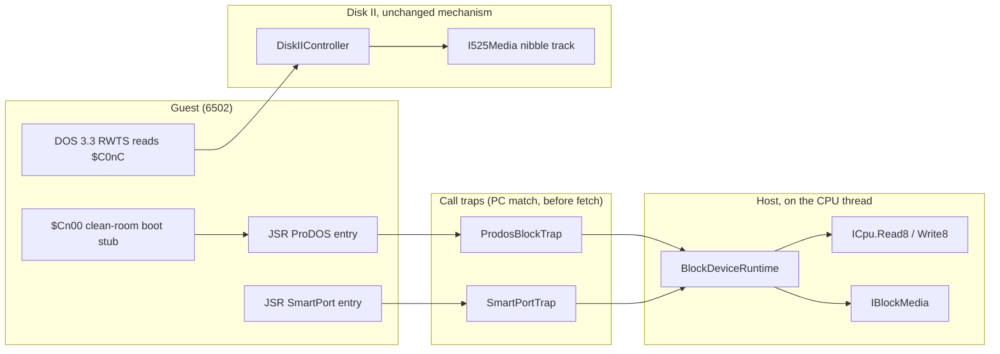

# PRD: Disk Emulation for Pocket2e

| Field | Value |
|---|---|
| Status | Normative |
| Owner | Josh |
| Tracking issue | #440 |
| Epic | #219 |
| Baseline | `main` at `42540b7` (Apple ROMs and disk images removed). `IMachineIoSession` is specified from PR #435, branch `copilot/headless-host-session-api` at `83e98a1`, which is not on `main`. |
| Supersedes | The May 2026 draft of this file, and [`DISK-IMPLEMENTATION-PLAN.md`](./DISK-IMPLEMENTATION-PLAN.md) (retired by this revision). |
| Related | `specs/os/Disk II Controller Device Specification.md`, `specs/os/SmartPort Specification.md` (corrections in §22), `specs/os/Disk Image Abstraction API Spec.md`, `KEYBOARD-SYSTEM-PRD.md`, `VIDEO-PIPELINE-PRD.md` |
| Speed | Disk II acceleration while the motor is on is epic #443. This spec does not trap RWTS. |
| Test firmware | Homebrew machine ROM work is #437. A clean-room Apple-compatible system ROM is #438 and is out of scope here. |

---

## 1. Summary

Pocket2e already boots 5.25" DOS 3.3 and ProDOS images through a real Disk II nibble path. This spec defines the rest of epic #219: block devices first, network boot immediately after, and bit-level WOZ last.

Block devices (SmartPort hard disk, SCSI hard disk, 3.5" UniDisk, host-backed RAM volumes, and the Workstation Card) share one clean-room design. Each card carries a tiny slot ROM that we author. ProDOS and SmartPort enter that ROM with a `JSR`. A call trap on the entry address runs on the host. The host copies a 512-byte block to or from emulated memory through the CPU bus, sets A and carry, and returns. No Apple or third-party ROM is shipped, and the emulator does not have to bit-bang a controller for software that uses the published block API.

DOS 3.3 stays on `DiskIIController`. Its RWTS loop keeps reading nibbles from `$C0nC`. Making that faster is #443 (run ahead while the motor is on), not a trap.

Where this spec and an open sub-issue of #219 disagree, this spec wins. #219's sub-issues are rewritten or filed from Appendix A after review. This document does not itself edit those issues.

## 2. Normative language

The key words MUST, MUST NOT, SHOULD, SHOULD NOT, and MAY are used as in RFC 2119.

"Current behavior" means what `main` does at the baseline above. Those statements are descriptive. Requirements use MUST or SHOULD.

## 3. Problem

The May 2026 draft described a storage stack and a Disk II that have since landed, and a SmartPort that has not. It also specified mechanisms the code does not have.

**Disk II is real.** `DiskIIController` (`[DeviceType("disk-ii-compatible")]`) implements the sixteen soft switches, the phase stepper, motor and track settling, on-demand nibble rotation (`CyclesPerByte = 32`), track read-back, and flush-before-eject. `I525Media` supplies the track. Sector images are nibblized by the storage layer. `.woz` and `.d13` are refused by `DiskImageFactory`.

**Profiles do not mount disks.** `MachineBuilder.FromProfile.ConfigureSlotCard` passes `SlotCardProfile.Config` into the slot-card factory and `LoadSlotCardRoms` loads `config.rom` by reflecting `LoadBootRom(byte[])`. Nothing reads `drive1` or `drive2`. The checked-in profiles `pocket2e.json`, `pocket2e-a2.json`, and `pocket2e-a2-enh.json` set both to `null` under slot 6. `SlotCardProfile` documents that shape. The factory for `disk-ii-compatible` ignores the JSON element. Mounting today is an explicit `IDiskController.Mount` from a test or from `disk insert`.

**The trap story in #195 is not the trap API.** `Cpu65C02.Step` calls `ITrapRegistry.TryExecute` when the program counter matches a registered address, before it fetches the opcode. The handler is:

```csharp
public delegate TrapResult TrapHandler(ICpu cpu, IMemoryBus bus, IEventContext context);
```

A handled trap adds `TrapResult.CyclesConsumed` to the CPU's cycle count. `TrapReturnMethod.Rts` performs a real RTS (pull the stacked address, add 1, charge 6 more cycles). `TrapReturnMethod.None` continues at `ReturnAddress` or at the current PC. There is no trap on illegal opcodes. An unimplemented opcode sets `HaltReason = HaltState.Stp`. `GameIOController` does not use `TrapRegistry`; it registers `IOPageDispatcher` reads for `$C060`–`$C067` and the `$C070`–`$C07F` paddle-trigger mirror. The only production registrar on `main` is `BreakpointManager`. `MachineBuilder.Build` constructs a concrete `TrapRegistry` and registers it as `ITrapRegistry` before device initialization, unless the caller already supplied one. That instance starts with no traps. Devices may add traps from `Initialize` or slot installation. Read and write traps exist on the registry and are not invoked by the CPU or the bus.

**Two storage models, one of them unused.** Live media is `BadMango.Emulator.Storage.Media`: `IStorageBackend`, `IBlockMedia`, `I525Media`, `IDiskController`, `DiskImageFactory`. `RamStorageBackend` and `RamCachedStorageBackend` exist. `DiskImageFactory.Open` uses `FileStorageBackend` (write-through). The per-track cache inside `DiskIIController` is write-back until flush. A second, unused hierarchy lives in `BadMango.Emulator.Devices.Interfaces` (`IStorageMedia`, `IBlockMedia`, `ITrackMedia`, `INibbleStreamMedia`, `IStorageDrive`, `IStorageController`, `IStorageControllerCard`, `IDiskImageTooling`). Nothing implements those types. `StorageAbstractionInterfaceTests` only checks that they exist.

**Headless disk I/O is not on main.** PR #435 adds `IMachineIoSession.MountDisk`, `EjectDisk`, and `ListDisks` on `MachineDebugSession`. `MountDisk` only accepts an `I525Media`. `EjectDisk` is documented there as Disk II unmount: flush, release, leave the drive empty. Eject signaling is explicitly not part of that operation. `ListDisks` returns `DiskControllerSnapshot` / `DiskDriveSnapshot` with Disk II fields (phase, quarter-track, motor). Calls are synchronous on the caller's thread; `DiskIIController` then posts mount and eject onto the machine thread and defers the swap by one cycle while the motor is on.

**Boot tests that need Apple media do not run in CI.** `42540b7` removed the ROMs and the disk images. `KeyboardMachineTests` and `ResetSignalMachineTests` call `Assert.Ignore` when `roms/` is absent. `ResetSignalMachineTests` also ignores a missing `disks/dos33-master.dsk`. `BitsyByeBootHarnessTests` is `[Explicit]` and calls `Assert.Inconclusive` when `disks/prodos243-master.po` is missing. New opt-in tests follow the `Assert.Ignore` pattern, not `Inconclusive`.

**#195, the old PRD, and `specs/os/SmartPort Specification.md` disagree with each other** about `$CnFF`, about which entry point is which, and about how a trap returns. Section 22 lists the corrections. This file is the contract for new work.

## 4. Goals

| # | Goal | Acceptance |
|---|---|---|
| G1 | DOS 3.3 and ProDOS 5.25" keep booting through the Disk II nibble path. | Existing controller tests stay green. No RWTS trap is added. A synthetic image built in the test mounts from a profile and a small guest reader sees sector bytes. |
| G2 | A profile that declares media mounts that media before the machine is returned. | A `drives[]` entry with an image is visible from `IDiskController` or `IBlockDeviceController` with no later `disk insert`. A missing image fails the build with a message that names the slot and the path. |
| G3 | ProDOS block I/O works for a SmartPort hard disk, a SCSI hard disk, a 3.5" unit, and a host-backed RAM volume. | For each, a synthetic 512-byte block written by the host is read back by a `JSR` to the card's ProDOS entry, through the bus, into a buffer in main RAM, aux RAM, and language-card RAM. |
| G4 | A hard disk boots a synthetic block 0 with no ProDOS image and no Apple ROM. | The clean-room `$Cn00` stub loads block 0 to `$0800` and enters `$0801` with X = `slot << 4`. The bytes at `$0801` were built in the test. |
| G5 | 3.5" media can be inserted and ejected, including a firmware eject and a force eject. | Soft eject and `CONTROL $04` unmount an idle removable unit. Force eject unmounts even when the unit is marked busy. A non-removable unit rejects every eject. |
| G6 | The same block runtime serves an Apple II Workstation Card equivalent. | A synthetic block image is reached through that card's ProDOS entry. No AppleTalk ROM is shipped. |
| G7 | Headless tests drive mount, run, and assert without Avalonia and without Apple media. | They use `IMachineIoSession` and `IDebugSession.ReadMemory` once #435 has landed. Until then they call the controller and the bus directly, behind the same assertions. |
| G8 | WOZ 1 and WOZ 2 can be read on the Disk II at bit level, after the block work. | A synthetic WOZ fixture resolves quarter-tracks, feeds the LSS, and produces the expected nibbles. Writes to a WOZ-backed drive fail with a clear read-only error. |
| G9 | Read-only DOS 3.3, ProDOS, and Pascal catalogs work on synthetic images. | The #374 bugs listed in §19 are fixed. No Apple master is checked in. |

## 5. Non-goals

- Trapping DOS 3.3 RWTS, the IOB, or any other Disk II software entry. Speed for that path is #443.
- Shipping Apple or third-party ROMs, boot disks, or ProDOS images. `pocket2-charset.rom` and the homebrew `boot.rom` from #437 remain the only ROM bytes the repository may contain.
- A clean-room replacement for the Disk II P5A/P6A ROMs (#438 covers a system ROM, not this card). User-supplied P5A images still load through `config.rom`.
- Register-level SmartPort, UniDisk packet, or NCR 5380 SCSI emulation. Section 11 states what those programs see instead.
- SCSI command passthrough, ASPI, and vendor CDBs.
- LocalTalk, AppleTalk, or AFP packet emulation. The Workstation Card is a block device. Section 16 says what the host side is.
- Volumes larger than 65 535 blocks of 512 bytes (32 MiB). That is the ProDOS 8 block-number width. Extended SmartPort still uses 24-bit fields, and a block number that does not fit the mounted volume is an error.
- ProDOS `/RAM` as a device we implement. ProDOS builds that volume in the IIe's auxiliary 64K, which the memory system already models. RamWorks, slinky, and other RAM-card hardware are not part of #219.
- GS/OS, DOS 3.2 (`.d13` stays recognized and rejected), WOZ writes, copy-protection authoring, Apple Pascal as a boot path, and a GUI for creating images.
- Avalonia mount menus and drive LEDs. Debug commands and `IMachineIoSession` are the v1 surfaces. The Disk II status window may keep reading `IDiskController`.

## 6. Users and scenarios

| Persona | Scenario |
|---|---|
| Player | A profile names a ProDOS hard-disk image in slot 7. Reset runs the clean-room stub, block 0 is copied to `$0800`, and the guest continues at `$0801`. |
| Player | `disk insert 5:1 work.po` mounts an 800K image in a removable 3.5" unit. `disk eject 5:1` flushes and removes it. `disk force-eject 5:1` removes it even if the unit is busy. |
| Player | Slot 7 is a SCSI card or a RAM volume. ProDOS block calls behave the same as SmartPort. The RAM volume can be saved back to an image. |
| Player | A Workstation Card in slot 2 boots a block image the host is serving. The guest never sees AppleTalk frames. |
| Developer | A test builds a 32-block image in memory, points `$0801` at `STA`/`STP`, boots `$C700`, and reads the marker with `IDebugSession.ReadMemory`. No file under `disks/` is required. |
| Developer | Ultima IV on a `.dsk` keeps using the nibble path. A `.woz` of the same title is a later opt-in, not a blocker for block devices. |

## 7. Priority and delivery order

Josh's order on 2026-11-16 is the delivery order. Appendix A is the issue split.

**Already on main.** Do not redo these: the storage assembly and GCR nibblizer (#203), `disk create` / `disk info` (#208), config plumbing into slot factories (#209), `DiskIIController` (#194), `disk drives` / `insert` / `eject` / `flush` (#210), and the DOS 3.3 and ProDOS 5.25" paths (#211, #212). What those boot issues could not do without Apple media is replaced by the synthetic tests below.

**P1, first.** SmartPort, 3.5", hard disk on both SmartPort and SCSI, and host-backed RAM volumes. Inside P1 the engineering order is:

1. Delete the unused `Devices.Interfaces` storage types (§20) so new code has one `IBlockMedia`.
2. Parse `drives[]` and mount declared media at machine build. Disk II mounts in this step. Block cards consume the same declarations when they exist.
3. Shared block runtime, clean-room slot ROM, ProDOS entry trap, and standard SmartPort commands.
4. Extended SmartPort commands, still under the 65 535 block cap.
5. SCSI card on that runtime.
6. Host-backed RAM volumes.
7. 3.5" removable units, soft eject, and force eject.
8. Synthetic hard-disk boot with no ProDOS image, then the same pattern for 3.5", SCSI, and RAM.
9. Teach `IMachineIoSession` to mount block images and run those boots headless.

The schema task (#217) is documentation and can land as soon as this spec is accepted. It does not wait for the cards.

**P2, closely after P1.** Network boot, including the Workstation Card equivalent, and the example profiles (#218).

**P3.** Read-only filesystem readers (#374, #341–#345). They do not depend on the new cards. They are not the critical path of this epic, and they are not pulled ahead of P1 or P2.

**P4, after the block and network work.** WOZ, split into parser, LSS engine, and Disk II integration (#216).

## 8. Project rules

These bind every implementation issue in Appendix A.

- Target `net11.0`, C# language version as set by `Directory.Build.props`. Nullable reference types stay on.
- New locks are `System.Threading.Lock`. New disk code has no static mutable fields. A `static readonly` template of slot-independent firmware bytes is allowed; the per-slot image is an instance array. The existing `DeviceFactoryRegistry` static map is not part of this work.
- No empty `catch`, and no `catch (Exception)` except a filtered clause that lists the types the callee is documented to throw. Log with an injected `Serilog.ILogger`. Best-effort teardown in `Dispose` logs and continues.
- Do not use `unsafe` for the block copy. A loop of `ICpu.Write8` / `Read8` over 512 bytes is the intended implementation. The Disk II hot path already avoids per-cycle allocation; block traps are not that path, and they still MUST NOT allocate on the success path after the first call (reuse a pooled or owner-held 512-byte buffer).
- Public types get XML docs. StyleCop stays clean. `dotnet build BackPocketEmulator.slnx -c Release -warnaserror` is the CI bar from `.github/copilot-instructions.md`.
- Tests are NUnit. They MUST pass under `dotnet test` and under the ReSharper runner: no `async void` tests, no tests that depend on static mutable fixtures, no `Assert.Inconclusive` for a missing optional file. A missing user-supplied ROM or disk image is `Assert.Ignore` with a message that names the missing path, matching `ResetSignalMachineTests` after `42540b7`.
- The product is unreleased. Changing `IDiskController` consumers, `IMachineIoSession`, or profile JSON is allowed. The three checked-in profiles that still say `drive1` / `drive2` are updated in the same change that starts enforcing `drives[]`.
- Log at mount, eject, profile failure, and the first ignored register-level access. Do not log per block on the success path.

## 9. Architecture



| Layer | Owns | Must not |
|---|---|---|
| Clean-room slot ROM | ID bytes, boot stub, `JSR` to the trapped entries, `STP` sentinels if the trap does not run. | Contain Apple or third-party bytes. Perform block I/O itself. |
| Call trap | Read the guest parameters, call the runtime, set A, X, Y, and carry, return `TrapResult`. | Touch a host file from a thread other than the CPU thread. Write RAM except through `ICpu`. |
| `BlockDeviceRuntime` | Units, media, disk-switched latch, timing, eject policy. | Know which card brand it is serving, beyond the device-type byte and the eject policy. |
| `IBlockMedia` | 512-byte blocks. | Know about slots, traps, or ProDOS. |
| `DiskIIController` | Nibble path for 5.25" disks, including DOS 3.3. | Gain a RWTS trap. |

`SmartPortCard`, `ScsiCard`, `WorkstationCard`, and a RAM unit are thin `ISlotCard` shells around one runtime. A 3.5" drive is a removable unit on a SmartPort card, not a second controller.

## 10. Disk II baseline

This section freezes the behavior new work must preserve.

### 10.1 Controller

- **FR-D1** `DiskIIController` remains the slot card `[DeviceType("disk-ii-compatible")]`. `DiskIIControllerStub` remains the no-media test double and is not selected by profiles.
- **FR-D2** Two drives. Phase stepper, motor settle (~1000 cycles), track-step settle (~30000 cycles), and on-demand spin (`elapsed / 32` bytes) stay as implemented. The NE556 one-second motor hold is not modeled; reset clears the motor, which is current behavior.
- **FR-D3** Writes hit the track cache and flush through `I525Media.WriteTrack` on motor-off, drive deselect, track change, eject, or `Flush`. A flush failure rejects eject and leaves the media mounted.
- **FR-D4** While the motor is on, `Mount` and `Eject` schedule the swap with `ScheduleAfter(Cycle.One, DeferredWork)` on the machine thread. With the motor off, or with no event context, they apply immediately so a pre-boot mount is visible. `Eject` returns `false` when the drive is empty or the probe flush throws. It returns `true` once the swap has been applied or scheduled. It does not refuse because the motor is on.
- **FR-D5** `LoadBootRom(byte[])` still installs a user-supplied 256-byte P5A image. With no ROM, `DiskIIBootRomStub` remains: ID bytes at `$05`, `$07`, `$0B`, `$0C`, and `RTS` at `$00`. That stub does not load a boot sector. Boot from a real P5A is opt-in.
- **FR-D6** DOS 3.3 and any other software that talks to `$C0n0–$C0nF` keeps doing so. No trap is registered on RWTS, on `$B700`, or on the boot ROM.

### 10.2 Images

`DiskImageFactory` on main opens `.dsk` (order sniffed), `.do`, `.po`, `.2mg`, `.2img`, `.nib`, and `.hdv`. It rejects `.d13` and `.woz` with a clear exception. Sector images expose both `I525Media` and `IBlockMedia`. That dual view stays. Block cards mount the block view. The Disk II mounts the track view.

`disk create` and `disk info` stay the way tests build images. New tests that need a file call that writer, or they build an `IBlockMedia` over `RamStorageBackend` and never touch the filesystem.

## 11. Block devices

### 11.1 Default design

Every block card MUST use the trap-backed stub in §13. The host copies blocks through the bus. The same `BlockDeviceRuntime` serves SmartPort, SCSI, 3.5" units, RAM volumes, and the Workstation Card.

Anything that works was in scope. The alternatives below were rejected.

| Alternative | Why it is not the default |
|---|---|
| Emulate the controller hardware first (IWM packet protocol, NCR 5380, Workstation Card SCC and ROM). | ProDOS only requires the block API. Hardware emulation needs ROMs we cannot ship and does not boot a synthetic block 0 any sooner. It remains the documented fallback if a program ignores the firmware. |
| Ship Apple's SmartPort, SCSI, or Workstation ROM, or a disassembly of one. | The repository does not ship those bytes. |
| Trap an illegal opcode inside the slot ROM, "the way `GameIOController` does." | Illegal opcodes halt the CPU. `GameIOController` is an I/O-page device, not a trap. Call traps are a PC match. See §3. |
| A mailbox in the card's `$C0nX` space, with a longer 6502 stub that stores the command there. | ProDOS `JSR`s the driver. A mailbox needs more stub code to marshal the same parameters the trap can read from zero page or the stack. |
| A full 6502 driver that bit-bangs a fake controller. | More ROM to maintain, slower, and no gain for clients of the block API. |
| Trap the ProDOS MLI entry globally and satisfy every MLI call on the host. | That couples the emulator to one operating system and would hide non-block MLI calls. The per-slot driver trap is the contract ProDOS already uses for every block card. |
| Trap DOS 3.3 RWTS so 5.25" disks take the fast path too. | RWTS traps only help unmodified DOS 3.3. Custom loaders and copy protection would break silently. #443 accelerates the machine while the Disk II motor is on, which helps every loader. |

### 11.2 Where the trap is not enough

Programs that do not `JSR` the firmware will not see a disk. That includes copy protection that inspects controller state, utilities that program a 5380, and the UniDisk's low-level packet protocol.

For those clients the v1 behavior is defined and deterministic:

- **FR-X1** SmartPort and Workstation cards MUST NOT expose a second protocol on the I/O page. Reads of their `$C0n0–$C0nF` return `$00`. Writes are ignored. The first such access at `Information` logs once that the card is firmware-only.
- **FR-X2** The SCSI card uses the same I/O-page behavior. It does not emulate a 5380. A later register-level device, if it is ever built, replaces this card behind the same `IBlockDeviceController` mount surface.
- **FR-X3** 3.5" units are block devices. There is no IWM bitstream for them in v1.
- **FR-X4** This fallback is not a promise to build the register-level device. Appendix A does not schedule it.

### 11.3 Timing

- **FR-T1** Each card has a timing mode, set from the profile, default `instant`.
- **FR-T2** `instant` charges a fixed cycle count per command: status 32, read 64, write 64, format 128, control and init 32. These counts are the `CyclesConsumed` of the trap. The CPU's RTS adds 6 more when the return method is `Rts`. Tests MAY rely on the sum.
- **FR-T3** `approximate` charges `cyclesPerBlock` on read, write, and format, default 4096, plus the `instant` fixed cost. Status, control, and init stay at the fixed cost. `cyclesPerBlock` MUST be a positive integer in the profile. The charge is a function of the command only. It MUST NOT read a clock, a timer, or a random source.
- **FR-T4** Both modes are deterministic: the same image bytes, the same call, and the same mode produce the same registers, the same memory, and the same cycle count. Headless replay depends on this.
- **FR-T5** The trap runs to completion inside `Cpu65C02.Step` on the CPU thread. File-backed `ReadBlock` / `WriteBlock` run on that thread. A 512-byte read is the expected cost. The handler MUST NOT `Post` work or wait on another thread.

## 12. Contracts

New types live in `BadMango.Emulator.Devices` unless noted. Interfaces that tests mock live next to the types they extend. `IBlockMedia` means `BadMango.Emulator.Storage.Media.IBlockMedia` only.

### 12.1 Volume declaration

```csharp
public enum VolumeKind { Floppy525, Floppy35, HardDisk, Ram, Network }

public enum VolumeBacking { Image, Ram }

public enum BlockTimingMode { Instant, Approximate }

public enum EjectKind { Unmount, Soft, Force }

public sealed record DriveDeclaration(
    int Unit,
    VolumeKind Kind,
    VolumeBacking Backing,
    string? Image,
    string? SaveImage,
    int? Blocks,
    bool Removable,
    bool WriteProtect);
```

`Unit` is 1-based and matches the debug command `slot:drive` and `IMachineIoSession`.

### 12.2 Block controller

```csharp
public interface IBlockDeviceController
{
    int SlotNumber { get; }
    int UnitCount { get; }
    bool ExposesSmartPort { get; }

    void Mount(int unitIndex, IBlockMedia media, string? imagePath, bool removable);

    bool Eject(int unitIndex, EjectKind kind);

    void Flush(int unitIndex);

    BlockUnitSnapshot GetUnit(int unitIndex);

    IBlockMedia? GetMedia(int unitIndex);
}

public readonly record struct BlockUnitSnapshot(
    bool HasMedia,
    bool Removable,
    bool WriteProtect,
    bool DiskSwitched,
    VolumeKind Kind,
    int BlockSize,
    int BlockCount,
    string? ImagePath);
```

`unitIndex` is 0-based. `IDiskController` stays the Disk II seam and still takes `I525Media`. A card is one or the other, not both. `IDiskController`'s remarks that mention SmartPort are updated so they stop promising that this interface mounts block media.

`Mount` follows the Disk II threading rule: the motor check does not apply, and the swap MUST still happen on the machine thread (`IMachineDispatcher.Post` when the machine has a dispatcher, inline otherwise). Block commands are synchronous, so "in flight" means a reentrancy flag the trap sets for the duration of the handler. A host eject posted to the machine thread runs before or after a trap, not in the middle of `Write8` loop, because both run on that thread.

### 12.3 Runtime

```csharp
public sealed class BlockDeviceRuntime
{
    public BlockDeviceRuntime(BlockTimingOptions timing, Serilog.ILogger logger);

    public void AddUnit(DriveDeclaration declaration, IBlockMedia? media, string? imagePath);

    public TrapResult HandleProdos(ICpu cpu, IMemoryBus bus, IEventContext context);

    public TrapResult HandleSmartPort(ICpu cpu, IMemoryBus bus, IEventContext context);
}
```

The card registers the two handlers. The runtime does not register traps itself, so a test can call `HandleProdos` with a fake CPU and bus.

`BlockTimingOptions` holds the mode and the cycle counts from FR-T2 and FR-T3.

### 12.4 Bus copy

```csharp
public static class BusBlockCopy
{
    public static void Write(ICpu cpu, ushort address, ReadOnlySpan<byte> data);
    public static void Read(ICpu cpu, ushort address, Span<byte> data);
}
```

`Write` calls `cpu.Write8` once per byte. `Read` calls `cpu.Read8`. Both MUST follow the CPU's current banking, including auxiliary memory and the language card. They MUST NOT write a `PhysicalMemory` buffer the card holds a pointer to. The 16-bit address wraps naturally as `ushort` arithmetic, which matches a 6502 indexed store that crosses `$FFFF`.

### 12.5 Session records

PR #435's `DiskDriveSnapshot` gains fields. The target shape, JSON camelCase through `DebugSessionJsonContext`, is:

```csharp
public sealed record DiskDriveSnapshot(
    int Drive,
    string Kind,
    bool Removable,
    bool Selected,
    bool MotorOn,
    int PhaseLatch,
    int QuarterTrack,
    bool WriteProtect,
    bool HasMedia,
    string? MountedImagePath,
    DiskGeometrySnapshot? Geometry,
    int? BlockSize,
    int? BlockCount,
    string? Error = null);
```

`Kind` is `floppy525`, `floppy35`, `hardDisk`, `ram`, or `network`. Disk II rows use `floppy525`, `Removable = true`, and a null block size. Block rows use zeros for `PhaseLatch` and `QuarterTrack`, `MotorOn = false`, and a null `Geometry` unless the image also has a 5.25" geometry. `DiskControllerSnapshot` is unchanged: slot, name, drive count, drives.

`IMachineIoSession` on that branch is extended, not replaced:

```csharp
void MountDisk(int slot, int drive, string path, bool writeProtect = false);

void EjectDisk(int slot, int drive, EjectKind kind = EjectKind.Unmount);

IReadOnlyList<DiskControllerSnapshot> ListDisks();
```

`MountDisk` resolves the path with `IDebugPathResolver` (`library://`, `app://`, absolute, relative). `embedded://` is rejected. The slot's card MUST implement `IDiskController` or `IBlockDeviceController`. A track image mounts on Disk II. A block image mounts on a block card. An image that exposes both views follows the card: track view on Disk II, block view on a block card. A mismatch (800K image on Disk II, 140K-only track image on a hard-disk unit) throws `InvalidOperationException` naming the slot, the drive, and the kind. Mount rollback stays as #435 implements it: if `MountedDiskRegistry.Track` fails, eject and dispose, and if that eject's flush fails, leave the image mounted and log.

`EjectDisk` without a kind, and `EjectKind.Unmount`, are today's Disk II unmount. On a 3.5" unit, `Unmount` and `Soft` are the soft eject. `Force` is the paperclip. On a non-removable unit every kind throws `InvalidOperationException`. `ListDisks` includes block controllers. Per-drive failures still become a row with `Error` set, and the listing continues.

Screen, keyboard, and `WaitForScreenText` are #435's contract and are not changed here.

## 13. Firmware and trap contract

### 13.1 Slot ROM

`BlockFirmwareImage.Create(int slot, int unitCount, bool anyRemovable)` returns 256 bytes. The slot page is `$C0 | slot` in the high byte of absolute operands, so slot 7 is `$C7` and the ROM sits at `$C700`. The ProDOS unit byte is a different value, `slot << 4` (`$70` for slot 7, drive 1). The image is generated in code from the map in Appendix B. It is not a blob checked into the repo, other than whatever a test asserts against that generator.

The published ProDOS block-device identification bytes MUST appear, because they are the interface ProDOS scans for, not a copyrighted ROM:

| Offset | Value | Role in our stub |
|---|---|---|
| `$01` | `$20` | Operand of `LDA #$20` |
| `$03` | `$00` | Operand of `LDY #$00` |
| `$05` | `$03` | Operand of `LDX #$03` |
| `$07` | `$00` | Operand of `CMP #$00` |
| `$FF` | `$80` | ProDOS entry is `$Cn00 + $80` = `$Cn80` |
| `$FE` | status | ProDOS device status byte. Not part of the four-byte scan. Layout and values are below. |

`$Cn07 = $00` is what distinguishes this card from a Disk II ROM, whose boot code has a different byte there. `DiskIIBootRomStub` uses a different, older ID layout (`$05`, `$07`, `$0B`, `$0C`). Block cards MUST NOT copy that layout.

The ProDOS entry is `$Cn80`. The SmartPort entry is `$Cn83` (ProDOS entry + 3). Both bytes are `STP` (`$DB`). If the trap is missing or `TrapCategory.SlotFirmware` is disabled, fetching that byte halts the CPU with `HaltState.Stp`. The handler is registered with `ITrapRegistry.Register(address, name, TrapCategory.SlotFirmware, handler)` for `TrapOperation.Call` in the default ROM context. Registration happens when the card is installed, on the machine's registry, never on a static registry.

`$Cn00` through `$Cn30` is ordinary 6502 that we wrote to satisfy the ID bytes and to boot. Appendix B is the listing. It sets the zero page, `JSR`s `$Cn80`, and on carry clear loads X with `slot << 4` and `JMP`s `$0801`. On carry set it executes `STP`.

The boot stub reads block 0 of unit 1 (drive 1 of this slot) to `$0800`. That is the ProDOS boot convention: the first byte of the block lands at `$0800` and execution starts at `$0801`. ProDOS boot blocks read X to learn which slot they were booted from, so the `LDX` is the instruction immediately before the `JMP`, after the `JSR` has returned. The earlier `LDX #$03` only plants the ID byte at `$05`.

**`$CnFE`.** ProDOS Technical Note #3, "ProDOS Device Search and Identification Procedure" (20 December 1983), defines this byte. ProDOS installs the driver only when bit 0 and bit 1 are both set. ProDOS 8 Technical Note #21 describes the same high nibble after ProDOS copies it into the unit number, and it states that bits 5–4 hold the volume count minus one. The bits are:

| Bit | Meaning | Our value |
|---|---|---|
| 7 | Medium is removable | 1 when any declared unit is removable, otherwise 0 |
| 6 | Device is interruptible | 0. These cards do not raise IRQ. |
| 5–4 | Number of volumes minus one, encoded 0–3 (1–4 volumes) | `min(unitCount, 4) - 1`. A count of 0 is rejected; a card has at least one unit. |
| 3 | Device supports FORMAT | 1 |
| 2 | Device can be written | 1. Per-unit write-protect is the SmartPort status bit, not this capability bit. |
| 1 | Device can be read | 1. Required. |
| 0 | Device can return status | 1. Required. |

A one-unit non-removable card (hard disk, SCSI, RAM, or network) is `$0F`. A one-unit removable card (3.5") is `$8F`. Two units set bits 5–4 to 1, so those bytes are `$1F` and `$9F`. The two classes differ by bit 7. Hard disk, SCSI, RAM, and network share the non-removable encoding; the DIB type byte is what distinguishes them.

### 13.2 ProDOS entry

On entry the handler reads zero page through `cpu.Read8`:

| Address | Contents |
|---|---|
| `$42` | Command: 0 status, 1 read, 2 write, 3 format |
| `$43` | Unit |
| `$44`–`$45` | Buffer, little-endian |
| `$46`–`$47` | Block number, little-endian |

The accumulator on entry is not the contract. ProDOS puts the command in `$42`. The handler MUST use `$42`.

The unit byte is `DSSS0000`: bit 7 selects drive 2, bits 6–4 are the slot, bits 3–0 MUST be zero. Slot 7 drive 1 is `$70`. Slot 7 drive 2 is `$F0`. Slot 6 drive 1 is `$60`. The formula "add `$10` for drive 2" in the old SmartPort notes is wrong; drive 2 sets bit 7. A unit whose slot nibble is not this card, or whose low nibble is not zero, returns bad unit.

This entry only addresses two units. Units 3–8 are reachable through the SmartPort entry. Drive 1 is unit 1. Drive 2 is unit 2.

Success is A = 0 and carry clear. Failure is A = the code in §13.5 and carry set. The handler writes `cpu.Registers.A` and the carry bit of `cpu.Registers.P`.

Status success also sets X to the low byte of the block count and Y to the high byte. Read, write, and format MAY change X and Y. Tests for those commands assert A and carry only.

The return is `TrapResult.Success(cycles)`, which is `TrapReturnMethod.Rts`. The caller must have `JSR`ed. A `JMP` to the entry is outside the contract, same as on hardware.

There are no inline parameter bytes. The handler MUST NOT adjust the stacked return address.

### 13.3 SmartPort entry

The caller `JSR`s `$Cn83` with three inline bytes:

```text
JSR $Cn83
.byte command
.word paramList
```

`Cpu65C02` has not fetched those bytes. The stacked return address is the last byte of the `JSR` (6502 `JSR` pushes the address of that byte). The CPU's RTS adds 1, so an unadjusted RTS would execute the command byte as code.

`PushByte` writes at `$0100 + SP` and then decrements SP, and `PopByte` increments SP and then reads. `JSR` pushes the high byte of `PC - 1`, then the low byte. At trap entry the low byte therefore sits at `$0100 + ((SP + 1) & $FF)` and the high byte at `$0100 + ((SP + 2) & $FF)`, where `SP` is `cpu.Registers.SP`. Those are the two bytes `TrapReturnMethod.Rts` will pop. The 16-bit value they form is the address of the last byte of the `JSR`. The command byte is at that address plus 1.

The handler MUST:

1. Read those two stack bytes with `cpu.Read8`. Do not change SP.
2. Read the command and the parameter pointer with `cpu.Read8`, starting at `stacked + 1`.
3. Add 3 to the stacked value and write the bytes back to the same two addresses. RTS adds one more, so execution resumes on the instruction after the inline word.
4. Return `TrapResult.Success(cycles)`.

The handler MUST NOT pop the return address itself. A fault from the stack read propagates; the handler does not catch it and does not return not-handled after a partial write. A normal `JSR` from RAM does not fault.

Standard commands and parameter lists are `specs/os/SmartPort Specification.md` §4.1 and §5, with the corrections in §22. v1 implements `$00` STATUS, `$01` READ, `$02` WRITE, `$03` FORMAT, `$04` CONTROL, `$05` INIT. `$06`–`$09` (character devices) return bad command. Extended commands `$40`–`$49` return bad command until the extended-command issue lands; after that they follow §13.4.

Parameter bytes are read with `cpu.Read8` so a list in auxiliary or language-card memory is the memory the guest stored.

### 13.4 Extended commands

Extended commands are the standard command with bit 6 set (`$40` STATUS through `$49` WRITE). The Apple IIgs Firmware Reference is the field layout: 24-bit block numbers and a buffer pointer that includes a bank byte. The implementation issue MUST name the table it coded against and lock the offsets with a test vector. This spec does not restate a layout it cannot verify from the tree.

Even after that issue:

- A block number greater than or equal to the unit's block count returns `$30` (volume too large / out of range) and does not touch the buffer.
- A bank byte other than 0 returns bad parameter. v1 does not write other banks. Lifting either limit is a later GS/OS decision, not a silent change.
- The ProDOS entry is unchanged and remains 16-bit.

### 13.5 Commands

Block size is 512. Block count MUST be in 1..65535 at mount. Mount outside that range throws before the machine is returned.

| Command | Behavior |
|---|---|
| Status, unit 0 | Writes the configured unit count (including empty removable bays) to the first byte of the status buffer. A = 0, carry clear. Does not report how many have media. |
| Status, unit 1–8, code `$00` | Four-byte device status from the SmartPort spec's status byte, then the 24-bit block count, little-endian. Offline (no media) returns `$2F` and does not write the buffer. |
| Status code `$03` | Device information block. Type and subtype come from §14.0. ID string is an ASCII name we choose (`SMARTPORT`, `SCSI`, `RAM`, `UNIDISK`, `WORKSTATION`), space-padded to 16, length set honestly. Firmware version is `$0100`. |
| Status code `$01` or `$02` | Bad command. We have no vendor DCB and no character device. |
| Read | Copies block `n` into the guest buffer via `BusBlockCopy.Write`. |
| Write | Copies the guest buffer out via `BusBlockCopy.Read`, then `IBlockMedia.WriteBlock`. |
| Format | On a writable unit, writes 512 zero bytes to every block. On a read-only unit, returns `$2B`. |
| Control `$00` | Clears the disk-switched latch. Does not destroy data. |
| Control `$04` | Soft eject of a removable unit (§15). Non-removable returns bad command. |
| Control `$01`, `$02`, `$03`, `$05` | Bad command. |
| Init | Same as control `$00`. |

Error codes are the SmartPort spec §6 values: `$00` ok, `$01` bad command, `$04` bad parameter count, `$21` bad unit, `$27` I/O error, `$28` no device, `$2B` write protected, `$2E` disk switched, `$2F` offline, `$30` block out of range. `$11` (bus error) is reserved and unused in v1.

**Disk switched.** Replacing media that was already mounted sets the latch. Mounting into an empty unit does not. The next command to that unit, including status, returns `$2E` and clears the latch, and does not read or write a block. The following command runs normally. Eject alone does not invent a latch on the empty unit; the next mount is a fresh volume.

**I/O errors.** `IBlockMedia` throwing `InvalidOperationException` (read-only) becomes `$2B`. `IOException` and `UnauthorizedAccessException` become `$27`, are logged, and are not wrapped in a bare catch. Anything else propagates.

### 13.6 Cards

```csharp
[DeviceType("smartport")]
public sealed class SmartPortCard : ISlotCard, IBlockDeviceController { }

[DeviceType("scsi")]
public sealed class ScsiCard : ISlotCard, IBlockDeviceController { }

[DeviceType("workstation")]
public sealed class WorkstationCard : ISlotCard, IBlockDeviceController { }
```

Each constructs a `BlockFirmwareImage` for its slot, installs it as the slot ROM, and registers the two traps when `ExposesSmartPort` is true. SCSI and Workstation expose the SmartPort entry as well as the ProDOS entry, so one guest path reaches every card. `ExposesSmartPort` is true for all three in v1.

Convention, not a hard rule: Disk II in slot 6, SmartPort or SCSI hard disk in slot 7, a second SmartPort with a 3.5" unit in slot 5 when slot 7 is the hard disk, Workstation in any free slot (slot 2 is the example). The enhanced IIe autostart scan lives in the user-supplied system ROM. We do not reimplement it. Synthetic tests `JMP` to the `$Cn00` of the card they are testing. An opt-in test MAY assert that a user-supplied ROM prefers slot 7 over slot 6, and MUST `Assert.Ignore` when that ROM is absent.

## 14. SmartPort, SCSI, 3.5", and RAM

### 14.0 DIB type and subtype

SmartPort Technical Note #4 (Matt Deatherage, November 1988) is the device-type list. Apple IIgs Technical Note #25 says the Firmware Reference's type list should match that note. The type byte is assigned. The subtype byte is not: SmartPort Technical Note #7 (November 1988), quoting the Apple IIgs Firmware Reference, defines it as characteristics, and reserved bits must be 0.

| Subtype bit | Meaning |
|---|---|
| 7 | 1 = supports extended SmartPort calls |
| 6 | 1 = supports disk-switched errors |
| 5 | 0 = removable media. A set bit means the media is not removable. |
| 4–0 | Reserved. Must be 0. |

Our cards implement extended calls and return `$2E` on a media change, so bits 7 and 6 are set. Bit 5 follows the unit. That is `$C0` for a 3.5" unit and `$E0` for a non-removable unit. `$C0` is also the subtype an Apple 3.5 Drive returns; Technical Note #7 says that match is the characteristic bits, not an identity. The ID string is what names our unit. Comparing the whole subtype byte to `$00` or `$C0` is the mistake that note warns against.

| Kind | Type | Subtype | Source for the type |
|---|---|---|---|
| RAM | `$00` | `$E0` | TN #4: Memory Expansion Card (RAM disk). The Firmware Reference's example subtype `$00` would claim removable media (bit 5 clear). Ours does not. |
| 3.5" | `$01` | `$C0` | TN #4: 3.5" disk. UniDisk Technical Note: a UniDisk 3.5 returns type `$01` subtype `$00`; an Apple 3.5 Drive returns `$01` / `$C0`. We use `$C0` because bits 7 and 6 are set. The old subtype `$01` sets a reserved bit and is not used. |
| Hard disk | `$02` | `$E0` | TN #4: ProFile-type hard disk. The old subtype `$01` sets a reserved bit and is not used. |
| SCSI | `$07` | `$E0` | TN #4: SCSI hard disk. `$04` in that note is a ROM disk, not a SCSI disk. `$03` is generic SCSI. |
| Network | `$02` | `$E0` | TN #4 has no AppleTalk or network type. `$0A` in that note is a 5.25" disk. A Workstation Card volume is a non-removable block device, so it uses the ProFile-type code. The ID string is `WORKSTATION`, and the profile kind stays `network`. |

### 14.1 SmartPort hard disk

- **FR-SP1** `smartport` hosts up to 8 units. A non-removable unit is a hard disk: `VolumeKind.HardDisk`, DIB type `$02`, subtype `$E0` (§14.0).
- **FR-SP2** Slot 7 is the usual boot slot because guest firmware scans downward. Two SmartPort cards in one machine are legal. Each has its own runtime and its own slot ROM.
- **FR-SP3** The standard command set in §13 ships first. Extended commands ship in the immediately following issue. Both are P1.

### 14.2 SCSI

- **FR-SC1** `scsi` is a different slot type so profiles and `ListDisks` can name it. It is not a SmartPort card with a different label only: the DIB device type is `$07` (SCSI hard disk, SmartPort Technical Note #4) and the card name is `SCSI`. Subtype is `$E0`.
- **FR-SC2** The ProDOS and SmartPort entries are the shared firmware and the shared runtime. There is no second command set.
- **FR-SC3** I/O-page behavior is FR-X2. No CDBs, no LUNs beyond the unit number, no 5380 registers.

### 14.3 3.5" UniDisk

- **FR-35A** A 3.5" drive is a `smartport` unit with `Kind = Floppy35`, `Removable = true`, and a block count of exactly 1600 (800K). DIB type `$01`, subtype `$C0` (§14.0). Any other block count at mount is an error that names the expected count.
- **FR-35B** The unit MAY omit `image` and start empty. `MountDisk` / `disk insert` supplies the image later. A non-removable unit MUST have media at the end of machine build.
- **FR-35C** Soft eject (`EjectKind.Soft`, `EjectKind.Unmount`, `disk eject`, SmartPort control `$04`) flushes, then unmounts, when the busy flag is clear. When the flag is set it returns `false` from `Eject` and `$27` from the guest control call, and the media stays. Guest control `$04` runs inside the trap, so the flag is set; the handler clears the flag before performing the eject that the command itself requested. The flag rejects a nested or host eject that arrives while a read or write is still inside `HandleProdos` / `HandleSmartPort`.
- **FR-35D** Force eject (`EjectKind.Force`, `disk force-eject`) flushes if it can. If the flush throws, it still drops the media, logs the failure, and returns `true`. The host has asked to give up the volume. A subsequent command sees the unit offline. Disk II does not have this split: `disk force-eject` on a Disk II drive is `Eject`, and a flush failure still leaves the disk mounted (FR-D3).
- **FR-35E** Insert and eject of a 3.5" unit reset the disk-switched latch as in §13.5 and reset no nibble state, because there is none.

### 14.4 Host-backed RAM volumes

- **FR-RAM1** A unit with `Backing = Ram` stores its blocks in a `RamStorageBackend` owned by the runtime. `Blocks` is required when no image is loaded, and MUST be in 1..65535. The buffer starts zeroed. DIB type `$00`, subtype `$E0` (§14.0). `Kind = Ram`. `Removable` MUST be false.
- **FR-RAM2** Optional `image` loads that file into the RAM buffer at mount. The file's block count MUST equal `Blocks` when `Blocks` is set, and sets the count when `Blocks` is omitted.
- **FR-RAM3** Optional `saveImage` is written on eject (RAM units are not ejectable from the guest, so this is machine dispose and an explicit `Flush`), using the same temp-file-and-replace pattern the image writer already uses for `disk create`. Dispose logs an `IOException` and does not throw out of `Dispose`. An explicit `Flush` that fails throws, so the caller learns the save did not happen.
- **FR-RAM4** ProDOS `/RAM` in auxiliary memory is not this unit. A test that wants a RAM volume declares one. Software that allocates `/RAM` itself keeps using aux memory and is not intercepted.

## 15. Profile and mount-at-build

### 15.1 Shape

`drive1` / `drive2` is retired. `config.drives` is an array for every storage card. A profile that still contains `drive1` or `drive2` fails machine build with a message that points at `drives`. The three checked-in profiles are migrated to an empty `drives` array (two entries with no image, units 1 and 2) so they still build a Disk II with empty drives.

```json
{
  "slot": 6,
  "type": "disk-ii-compatible",
  "config": {
    "rom": "a2-enh-diskii-s6-rom",
    "timing": "instant",
    "drives": [
      { "unit": 1, "image": "library://disks/game.dsk", "writeProtect": false },
      { "unit": 2 }
    ]
  }
}
```

```json
{
  "slot": 7,
  "type": "smartport",
  "config": {
    "timing": "approximate",
    "cyclesPerBlock": 4096,
    "drives": [
      { "unit": 1, "kind": "hardDisk", "image": "library://disks/hd.po" },
      { "unit": 2, "kind": "ram", "blocks": 2048, "saveImage": "library://disks/ram.po" },
      { "unit": 3, "kind": "floppy35", "removable": true }
    ]
  }
}
```

`timing` is `instant` (default) or `approximate`. `cyclesPerBlock` is allowed only with `approximate`.

On `disk-ii-compatible`, every drive is `floppy525` and removable. `kind` and `removable` MUST be omitted or set to those values. `backing` is `image`. An empty drive omits `image`.

On a block card, omitted `kind` means `hardDisk` when `backing` is `image` and `removable` is false, `ram` when `backing` is `ram`, and `floppy35` when `removable` is true. An explicit `kind` that contradicts the block count or the backing fails the build. `removable: false` with no image and a backing of `image` fails the build. `removable` defaults to false.

`unit` values MUST be unique, in 1..8 for block cards and in 1..2 for Disk II, and SHOULD be contiguous from 1. A gap is allowed and still consumes a unit number (unit 2 with no unit 1 is a hard disk whose boot unit is empty, which is legal and will not boot).

### 15.2 When the mount happens

- **FR-P1** After `ConfigureSlotCard` has constructed the card and loaded `config.rom`, and before `MachineBuilder` returns the machine, the builder mounts each declared drive. The card MUST implement a new `IProfileStorageCard.Apply(DriveDeclaration, mounted media)` or the builder calls `IDiskController.Mount` / `IBlockDeviceController.Mount` directly. One parser produces `DriveDeclaration` values. Cards do not re-parse JSON.
- **FR-P2** Image paths are resolved with the `ProfilePathResolver` already used for ROM sources: `library://`, `app://`, absolute, and relative to the profile file. `embedded://` MUST be rejected for disk images, with the same rationale as `IDebugPathResolver` (disk I/O is not an assembly resource). A missing file, a bad format, or a kind mismatch throws `InvalidOperationException` and the machine is not returned.
- **FR-P3** Unknown slot `type` values keep today's behavior: `ConfigureSlotCard` skips them. A known storage type with a bad `drives` entry MUST NOT skip; it fails the build.
- **FR-P4** Non-ejectable media is declared here. Removable media MAY be declared here or inserted later. Both paths share `Mount`.
- **FR-P5** `schemas/machine-profile.schema.json` gains a definition for this object. Today `slotCard.config` is an open object. The schema task (#217) adds the closed shape for the three storage types and leaves other cards open.

## 16. Network boot and the Workstation Card

P2. The card is `[DeviceType("workstation")]`. It uses §13's ROM and traps. The DIB type is `$02` with subtype `$E0` (§14.0), because SmartPort Technical Note #4 does not assign a network type. `VolumeKind.Network`. Units are non-removable in v1: the "server volume" is mounted at build or by `MountDisk`, and guest control `$04` returns bad command.

The host side is a block source, not a network stack.

```csharp
public interface IBlockVolumeSource
{
    IBlockMedia Open();
}
```

The v1 implementation `ImageBlockVolumeSource` opens a path through `DiskImageFactory` and returns the `IBlockMedia`. The runtime that mounts it owns that object and disposes it on eject or on dispose of the card. The profile expresses that as a normal `drives[]` image entry with `kind: "network"`. Tests use a `RamStorageBackend` source directly and do not need the profile.

A later bridge MAY implement `IBlockVolumeSource` over a host directory or a real server. It is not in Appendix A's P2 issue. Packet-level LocalTalk, the SCC, and AFP login are a later epic (decision 11).

What a synthetic test can prove: the slot ROM's ID bytes, a `JSR` to the ProDOS entry, a block copied into guest memory, boot of a synthetic block 0, and `ListDisks` showing `kind = network`. What it cannot prove: that a real AppleShare server would log the machine in. We do not claim that.

## 17. WOZ and the LSS

P4, and not a blocker for any goal in §4 except G8. `.dsk` images, including copy-protected titles that happen to be stored as nibbles, keep using the nibble path.

#216 splits into three issues that can be reviewed separately.

**Parser.** A WOZ 1 and WOZ 2 reader produces an immutable model: INFO, TMAP, TRKS, and the optional META and WRIT chunks, with the checksum checked. Quarter-track to track-block mapping, including the empty-track sentinel, is a pure function with tests. The reader does not touch `DiskIIController`. `DiskImageFactory` grows a `.woz` arm that returns this model wrapped as read-only `I525Media` only after the integration issue. Until then the factory may keep rejecting `.woz`.

**LSS engine.** A pure type takes a bitstream, a cycle count, and the current sequencer state, and returns the next data-latch value and state. It is the bit-cell path (about 4 CPU cycles per bit) for weak bits and timing-sensitive loaders. It has no bus, no scheduler, and no file I/O. Sector-backed images do not use it.

**Integration.** `DiskIIController` selects the LSS path when the mounted media is WOZ-backed and the nibble path otherwise. Writes return a clear read-only failure and do not modify the file. Quarter-tracks follow the WOZ TMAP, including several quarter-tracks sharing a block and unformatted holes. A synthetic fixture, built in the test, is the acceptance test. A user-supplied commercial WOZ MAY be an `Assert.Ignore` opt-in and is not the CI test.

The P6 PROM is not required for the LSS engine. A cycle-accurate PROM model is a possible later replacement behind the same engine interface, and it is not scheduled here.

## 18. Debug commands

Existing commands stay. The extensions are:

| Command | Requirement |
|---|---|
| `disk drives` | Includes block controllers. `--json` matches §12.5 once #435's JSON path exists. |
| `disk insert` | Works for removable block units. Rejects non-removable units and kind mismatches with a message that says which. |
| `disk eject` | Disk II: FR-D4. 3.5": soft eject. Non-removable: error. |
| `disk force-eject` | New. Disk II: alias of `disk eject`. 3.5": FR-35D. Non-removable: error. |
| `disk flush` | Calls `Flush` on either controller. |
| `disk create` / `disk info` | Unchanged. They remain the supported way to build a file image in a test. |

Paths keep going through `IDebugPathResolver`. Commands that report a path SHOULD print both the form the user typed and the resolved path when they differ.

`diskmon` continues to read `IDiskController.GetActivitySnapshot`. Block cards do not have to implement that snapshot. A block-activity surface is out of scope.

## 19. Read-only filesystems

Sub-epic #374. Priority P3. The readers are pure functions over `IBlockMedia` or a sector view. They do not mount anything and they do not write.

The normative contracts from the open issues, plus the bug list that a salvage of the old spike MUST NOT reintroduce:

- **#341** `IAppleFileSystem` with volume name, type, `ListDirectory`, `TryReadFile`, and `GetFileInfo`. `FileEntry` is an immutable record (type byte, aux type, sizes, locked, directory, path, storage kind). `ISectorReader` and `IBlockReader` wrap media; readers do not take `Func`s. `AppleFileSystemDetector` returns a result that names every format it tried and why. It MUST NOT swallow exceptions. Fixtures are synthetic images built in the test. `p203.dsk` and `disks/prodos203-master-clean.dsk` MUST NOT be reintroduced.
- **#342** DOS 3.3. VTOC and catalog chain. Type and locked flag at entry offset `+2`, not `+0`. Deleted entries are track `$FF`. The file reader follows that file's TS list, allows sparse entries, and refuses a loop. Optional logical view strips A/I/B headers. Volume name MAY be the volume number; DOS 3.3 has no text volume name.
- **#343** ProDOS. The volume-directory header is not a file. Subdirectories honor the path. Seedling, sapling, and tree reads use the low-half / high-half index block. Sparse blocks are zeros. Output is trimmed to EOF. Storage type `$5` (extended) returns an unsupported result, never invented bytes. Works on 140K, 800K, and hard-disk images.
- **#345** Pascal. The constructor rejects a volume whose header is not Pascal. Directory entries are the 26-byte records. File reads work on a synthetic image.
- **#344** `disk fsinfo`, `disk ls`, and `disk cat` are resolved from DI. Sources are a mounted `slot:drive` or `--image` with no machine. `cat` supports `--hex`, `--raw` / `--logical`, and `--to` confined to a configured output root. JSON uses the shared debug envelope when that envelope exists. No dead `ListDos33Files` copy.

Write support for these filesystems is out of scope until the readers have tests.

## 20. Orphaned interfaces

The following types in `src/BadMango.Emulator.Devices/Interfaces` and the support types under `src/BadMango.Emulator.Devices/Storage` have no implementers and no callers other than `StorageAbstractionInterfaceTests`:

- `IStorageMedia`, `IStorageDrive`, `IStorageController`, `IStorageControllerCard`
- `Devices.Interfaces.IBlockMedia`, `ITrackMedia`, `INibbleStreamMedia`
- `IDiskImageTooling`
- `ControllerMetrics`, `DriveMetrics`, `ControllerDriveChangeKind`, `ControllerEventArgs`, `DiskImageCreationOptions`

They MUST be deleted, along with the reflection test that only exists to pin them. Image creation stays in `DiskCreateCommand` and `DiskImageFactory`. The live controller seam is `IDiskController` for Disk II and `IBlockDeviceController` for block cards.

This is safe because the product is unreleased and nothing outside the repo can be linked against these types. The deletion is its own small issue so the block-device work does not mix a drive-by delete with new firmware.

## 21. Testing

Synthetic means the bytes are produced in the test process. No test adds a file under `roms/` or `disks/`. A test that wants a user-supplied ROM or a commercial image checks `File.Exists` and calls `Assert.Ignore`.

| Test | Asserts |
|---|---|
| Firmware generator | Appendix B bytes for slot 7, one unit, not removable: ID bytes, `$CnFF = $80`, `$CnFE = $0F`, both `STP` sentinels, the `LDX #$70` before `JMP $0801`, and the patched slot page `$C7` in the `JSR` and the boot unit `$70`. Repeat for slot 5 (`$C5`, unit `$50`, `LDX #$50`). A one-unit 3.5" image differs at `$CnFE` (`$8F`). |
| ProDOS read / write / status | Fake CPU and bus, or a real machine. Command in `$42`, buffer in `$44`, block in `$46`. A and carry. Status sets X and Y. Bad unit, offline, write-protect, and out-of-range block. |
| Banking | Buffer at `$0800` (main), buffer in auxiliary memory with aux write enabled, buffer at `$D000` with language-card RAM write enabled. The other bank is unchanged. |
| Disk switched | Replace a mounted volume. The next call returns `$2E` and does not deliver data. The call after that does. |
| SmartPort inline | A real `JSR` in guest RAM. Execution resumes after the parameter word. The stacked address was adjusted by 3 and the CPU's RTS added 1. |
| Trap miss | Category disabled, or no registry. The CPU halts with `HaltState.Stp` on the `STP` at the entry. |
| Timing | `instant` and `approximate` cycle counts, including the extra 6 for RTS. Two runs match. No wall clock is read (a test can substitute a scheduler and compare cycles only). |
| Profile mount | A temp image, a profile, `FromProfile`. The controller's unit 1 has that media. `drive1` in the JSON throws. A missing file throws. `embedded://` throws. An empty Disk II `drives` array builds. |
| Hard-disk boot | Block 0 is a program built in the test: at offset 1, store a marker and `STP`. PC set to `$Cn00`. When PC reaches `$0801`, X equals `slot << 4` (`$70` in slot 7). After run, `ReadMemory` shows the marker and the CPU is stopped. No ProDOS image, no Apple ROM. This is the rewrite of #213 (D9). |
| 3.5" boot | Same pattern, 1600-block volume, removable, including X = `slot << 4` at `$0801`. |
| SCSI and RAM boot | Same pattern through those device types, including the X check. |
| DIB types | STATUS `$03` returns the type and subtype from §14.0: RAM `$00`/`$E0`, 3.5" `$01`/`$C0`, hard disk `$02`/`$E0`, SCSI `$07`/`$E0`, network `$02`/`$E0`. |
| Eject | Soft eject refused while the busy flag is held (call `Eject` from a test hook the handler exposes, or set the flag through an internal test seam). Force eject drops the media anyway. Disk II force-eject matches eject, including flush failure. Non-removable eject throws. |
| Session | Once #435 is on main: `MountDisk` of a block image, `ListDisks` JSON kind and block count, `EjectDisk` with `Force`. Until then the controller tests above are the gate, and the session tests are added in the same issue that extends the interface. |
| DOS 3.3 regression | A synthetic 35-track image from `disk create` or the nibblizer, mounted by the profile. A guest loop that mimics a sector read (or the existing controller nibble test) sees the address field and the data bytes. It does not call RWTS in the Apple ROM. |
| Opt-in | User P5A plus a user disk image, `Assert.Ignore` when either file is absent. Not required for CI. |
| WOZ | Parser vectors and an LSS vector from bytes the test builds. Integration test uses that fixture. |
| Filesystems | Catalog and read against images the test builds. One test per bug named in §19. |
| ReSharper | The new fixtures do not use `Assert.Inconclusive`. Ignored opt-in tests show as skipped. |

`dotnet test BackPocketEmulator.slnx -c Release` is the run. The build that must be clean is `dotnet build BackPocketEmulator.slnx -c Release -warnaserror`.

## 22. Corrections

### 22.1 `specs/os/SmartPort Specification.md`

That file remains the command and error-code reference. Where it disagrees with this spec, this spec wins.

- §3.1 requires `$CnFF = $00` and also uses `$CnFF` as the ProDOS entry offset. Both cannot be true. `$CnFF` is the offset and MUST be non-zero. v1 uses `$80`.
- §3.1 requires `$CnFE = $FF`. Bits 0 and 1 of `$FF` are clear, so ProDOS Technical Note #3 will not install that driver. This spec writes the status byte from §13.1 (`$0F` for one non-removable unit, `$8F` for one removable unit).
- §7.1's device-type table does not match SmartPort Technical Note #4. SCSI hard disk is `$07`, not `$04` (`$04` is a ROM disk). `$0A` is a 5.25" disk, not AppleTalk. 3.5" subtype is the characteristic byte from Technical Note #7, not `$01`. See §14.0.
- §8.1's formula `(D-1) * $10` disagrees with its own example (`$D0`, bit 7). Bit 7 selects drive 2. See §13.2.
- §8.2's zero-page map (`$42` command, `$43` unit, `$44`–`$45` buffer, `$46`–`$47` block) is the ProDOS entry contract. The accumulator is not.
- §10.3's sample calls `cpu.PopWord`, `cpu.SetCarry`, and `cpu.A`, and it uses `bus.Read16` / `bus.Write8(ushort)`. The real handler signature is `TrapHandler`. Registers are `cpu.Registers`. Guest memory goes through `ICpu.Read8` / `Write8`. The sample is not implementable as written.
- §10.3 returns via RTS after rewriting the stacked address. That part of the idea is right for the SmartPort entry only. The CPU RTS adds 1, so the adjustment is +3 on the stacked value, not a hand-rolled pop that also skips the RTS.
- §11.1's `IPeripheral` is not our slot interface. Cards implement `ISlotCard`.
- §11.2 repeats `$CnFF = $00` and places the SmartPort entry at `$CnFC`. The SmartPort entry is three bytes after the ProDOS entry, and the ProDOS entry is `$Cn00 + ($CnFF)`.

### 22.2 The May 2026 draft of this PRD

Removed as a draft. In particular: SCSI is in scope; network boot is in scope; WOZ is P4 rather than a peer of SmartPort; the trap is not an illegal opcode and is not the `GameIOController` pattern; profiles use `drives[]` and actually mount; hard-disk boot tests do not need a ProDOS image; DOS 3.3 is not accelerated here.

### 22.3 `DISK-IMPLEMENTATION-PLAN.md`

Retired. It sequenced WOZ before a finished SmartPort, listed SCSI as out of scope, and described the same trap that does not exist.

## 23. Decisions

1. **`drives[]` for every storage card.** `drive1` / `drive2` fails the build. Checked-in profiles are migrated.
2. **One block runtime, three slot types** (`smartport`, `scsi`, `workstation`), plus 3.5" and RAM as units.
3. **Call traps at `$Cn80` and `$Cn83`**, category `SlotFirmware`, return via the CPU's RTS.
4. **32 MiB cap** (65 535 blocks). Extended calls exist so the format is right. They do not raise the cap.
5. **`instant` timing by default.** `approximate` is opt-in and still deterministic.
6. **Disk II eject is unmount.** 3.5" adds soft and force. Force on Disk II is unmount.
7. **Orphan `Devices.Interfaces` storage types are deleted.**
8. **Synthetic CI, `Assert.Ignore` for user media.**
9. **DOS 3.3 speed is #443.**
10. **`$CnFE` is the ProDOS status byte** from Technical Note #3, with bits 5–4 holding the volume count minus one (Technical Note #21). One non-removable unit is `$0F`. One removable unit is `$8F`. Bits 0 and 1 stay set.
11. **Network boot v1 is a Workstation-Card-shaped block device over an image.** AppleTalk, the SCC, and AFP are a later epic. Josh, 2026-11-17.
12. **ProDOS `/RAM` stays auxiliary memory.** RamWorks and slinky stay out of #219 and are a separate item later. Josh, 2026-11-17.

## 24. Open questions

None. The two questions that were here are decisions 11 and 12.

## 25. Sources

- `src/BadMango.Emulator.Bus/TrapRegistry.cs`, `Interfaces/ITrapRegistry.cs`, `TrapHandler.cs`, `TrapResult.cs`, `TrapCategory.cs`
- `src/BadMango.Emulator.Emulation/Cpu/Cpu65C02.cs` (`Step`, trap before fetch) and `Cpu65C02OpcodeTableBuilder.cs` (`STP` at `$DB`, illegal opcode halts)
- `src/BadMango.Emulator.Devices/GameIOController.cs` (`IOPageDispatcher`, not traps)
- `src/BadMango.Emulator.Devices/DiskIIController.cs`, `DiskIIBootRomStub.cs`
- `src/BadMango.Emulator.Bus/MachineBuilder.FromProfile.cs` (`ConfigureSlotCard`, `LoadSlotCardRoms`)
- `src/BadMango.Emulator.Core/Configuration/SlotCardProfile.cs`, `ProfilePathResolver.cs`
- `src/BadMango.Emulator.Storage/Media/IBlockMedia.cs`, `IDiskController.cs`, `Formats/DiskImageFactory.cs`
- `src/BadMango.Emulator.Devices/Interfaces/IBlockMedia.cs` and the neighboring unused storage interfaces
- `src/BadMango.Emulator.Debug.Abstractions/IDebugSession.cs` (`ReadMemory`)
- PR #435 branch `copilot/headless-host-session-api`: `IMachineIoSession`, `MachineDebugSession` mount/eject/list
- `.github/copilot-instructions.md` (net11, warnings as errors, `Lock`, empty catches)
- Issues #195, #213–#218, #341–#345, #374, #437, #440, #443
- Commit `42540b7`
- ProDOS Technical Note #3, "ProDOS Device Search and Identification Procedure" (20 December 1983): `$CnFE` bit layout. Bits 0 and 1 must be set.
- ProDOS 8 Technical Note #21, "Identifying ProDOS Devices": bits 5–4 of `$CnFE` are the volume count minus one.
- SmartPort Technical Note #4, "SmartPort Device Types" (Matt Deatherage, November 1988): type bytes. Apple IIgs Technical Note #25 points the Firmware Reference at this list.
- SmartPort Technical Note #7, "SmartPort Subtype Codes" (November 1988): subtype bits, citing the Apple IIgs Firmware Reference.
- UniDisk 3.5 Technical Note on signature bytes: type `$01` subtype `$00` for a UniDisk 3.5, type `$01` subtype `$C0` for an Apple 3.5 Drive.

## Appendix A. Proposed sub-issue breakdown

For epic #219. "Rewrites" means the existing issue's acceptance criteria are replaced by this row when the issue is edited. This appendix does not edit GitHub. Sizes are relative: S is a focused change with a handful of tests, M crosses a component boundary, L is a new card plus its traps and tests.

| ID | Title | Rewrites | Depends on | Size | Priority |
|---|---|---|---|---|---|
| D1 | Mount `drives[]` at machine build, and migrate the checked-in profiles off `drive1` / `drive2` | NEW (closed #209 plumbed config and did not mount) | — | M | P1 |
| D2 | Delete the orphaned `Devices.Interfaces` storage types and their reflection test | NEW | — | S | P1 |
| D3 | SmartPort card: clean-room stub, ProDOS trap, standard SmartPort commands | Replaces #195, first half | D1, D2 | L | P1 |
| D4 | SmartPort extended commands under the 65 535 block cap | Replaces #195, second half | D3 | M | P1 |
| D5 | SCSI card on the shared block runtime, I/O page defined and not a 5380 | NEW | D3 | M | P1 |
| D6 | Host-backed RAM volumes, including optional load and save images | NEW | D3 | M | P1 |
| D7 | 3.5" removable units: insert, soft eject, force eject, `disk force-eject` | Rewrites #214 | D3 | M | P1 |
| D8 | 3.5" synthetic boot (1600 blocks, no ProDOS image) | Rewrites #215 | D7 | S | P1 |
| D9 | Hard-disk synthetic boot with no ProDOS image and no Apple ROM; X = slot*16 at `$0801` | Rewrites #213 | D3 | S | P1 |
| D10 | Extend `IMachineIoSession` to block images and run the synthetic boots headless | NEW. Builds on #435 | D1, D3, D9, and #435 on main | M | P1 |
| D11 | Schema and Machine Profile Configuration Guide for `drives[]`, `smartport`, `scsi`, `workstation` | Rewrites #217 as a Task | This spec | S | P1 |
| D12 | Example profiles that validate and mount a synthetic image in a test | Rewrites #218 as a Task. Drops the requirement to boot a user-supplied ROM | D11, D1, D3 | S | P2 |
| D13 | Workstation Card and network boot over `IBlockVolumeSource` | NEW | D3 | L | P2 |
| D14 | `Storage.FileSystems` contracts and synthetic fixtures | Rewrites #341 | — | S | P3 |
| D15 | DOS 3.3 reader, fixing the type-byte and TS-list bugs | Rewrites #342 | D14 | M | P3 |
| D16 | ProDOS reader, fixing sapling layout, subdirectories, and tree files | Rewrites #343 | D14 | M | P3 |
| D17 | Apple Pascal reader | Rewrites #345 | D14 | S | P3 |
| D18 | `disk fsinfo` / `ls` / `cat`, including `--image`, on the shared JSON envelope | Rewrites #344 | D14 and either D15 or D16 | S | P3 |
| D19 | WOZ 1 and WOZ 2 parser, no controller changes | Splits #216 | — | M | P4 |
| D20 | Pure LSS bit engine over a caller-supplied bitstream | Splits #216 | — (D21 is what joins it to D19) | L | P4 |
| D21 | Wire the LSS into `DiskIIController`, read-only, synthetic fixture | Splits #216 | D19, D20 | M | P4 |

#374 remains the parent of D14–D18. #195 is closed by D3 and D4 together, not by D3 alone. #216 is closed by D19–D21 together. #213's old "user-supplied ProDOS 2.4.3 image autoboots" check becomes an `Assert.Ignore` opt-in beside D9, not the acceptance test. D10 is the headless regression suite for Disk II (synthetic sector read), SmartPort, SCSI, RAM, and 3.5" once those cards exist; D9 lands the first boot test earlier so D3 does not wait for the session API.

Closed issues #203, #208, #209, #194, #210, #211, and #212 stay closed.

## Appendix B. Clean-room slot ROM

`BlockFirmwareImage.Create(slot, unitCount, anyRemovable)` emits this image. `page` is `$C0 | slot` (`$C7` for slot 7). `unit` is `slot << 4` (drive 1, bit 7 clear, `$70` for slot 7). The listing is the one-unit non-removable card, so `$CnFE` is `$0F`. Bytes the table does not name are `$EA`: `$31`–`$7F`, `$81`–`$82`, and `$84`–`$FD`. The generator is the source of truth; a test locks slot 7 and slot 5.

| Offset | Bytes | Instruction | Why |
|---|---|---|---|
| `$00` | `A9 20` | `LDA #$20` | ID byte `$20` at `$01` |
| `$02` | `A0 00` | `LDY #$00` | ID byte `$00` at `$03` |
| `$04` | `A2 03` | `LDX #$03` | ID byte `$03` at `$05` |
| `$06` | `C9 00` | `CMP #$00` | ID byte `$00` at `$07`. A is `$20`, so the compare only sets flags the next instructions replace. |
| `$08` | `4C 10 page` | `JMP $page10` | Enter the boot stub. Does not fall into the ID bytes. |
| `$0B`–`$0F` | `EA` | `NOP` | Padding before the boot stub. |
| `$10` | `A9 01` | `LDA #$01` | |
| `$12` | `85 42` | `STA $42` | Command = read |
| `$14` | `A9 unit` | `LDA #unit` | |
| `$16` | `85 43` | `STA $43` | This slot, drive 1 |
| `$18` | `A9 00` | `LDA #$00` | |
| `$1A` | `85 44` | `STA $44` | Buffer `$0800` low |
| `$1C` | `85 46` | `STA $46` | Block 0 low |
| `$1E` | `85 47` | `STA $47` | Block 0 high |
| `$20` | `A9 08` | `LDA #$08` | |
| `$22` | `85 45` | `STA $45` | Buffer high |
| `$24` | `A9 01` | `LDA #$01` | |
| `$26` | `20 80 page` | `JSR $page80` | ProDOS entry trap |
| `$29` | `B0 05` | `BCS $30` | Carry set skips the `LDX` and the `JMP`. |
| `$2B` | `A2 unit` | `LDX #unit` | `unit` is `slot << 4` (`$70` in slot 7). ProDOS boot blocks read X for the boot slot. |
| `$2D` | `4C 01 08` | `JMP $0801` | |
| `$30` | `DB` | `STP` | Carry set: halt |
| `$80` | `DB` | `STP` | ProDOS entry. Not fetched when the trap handles. |
| `$83` | `DB` | `STP` | SmartPort entry. |
| `$FE` | `0F` | | One unit, not removable. §13.1. A one-unit 3.5" card is `$8F`. |
| `$FF` | `80` | | Entry offset |

The early `LDX #$03` only plants the ID byte at `$05`. The `LDX` at `$2B` runs after the ProDOS `JSR` returns, so X at `$0801` is `slot << 4` even if the trap changed X. Y is not part of the boot contract.

## Appendix C. Command numbers

Standard SmartPort, implemented by D3: `$00` status, `$01` read, `$02` write, `$03` format, `$04` control, `$05` init. `$06`–`$09` return bad command.

Extended, implemented by D4: `$40`–`$45` for the same six operations, `$46`–`$49` return bad command. Layout per §13.4.

ProDOS entry commands are `$00`–`$03` only. Any other value in `$42` is bad command.
