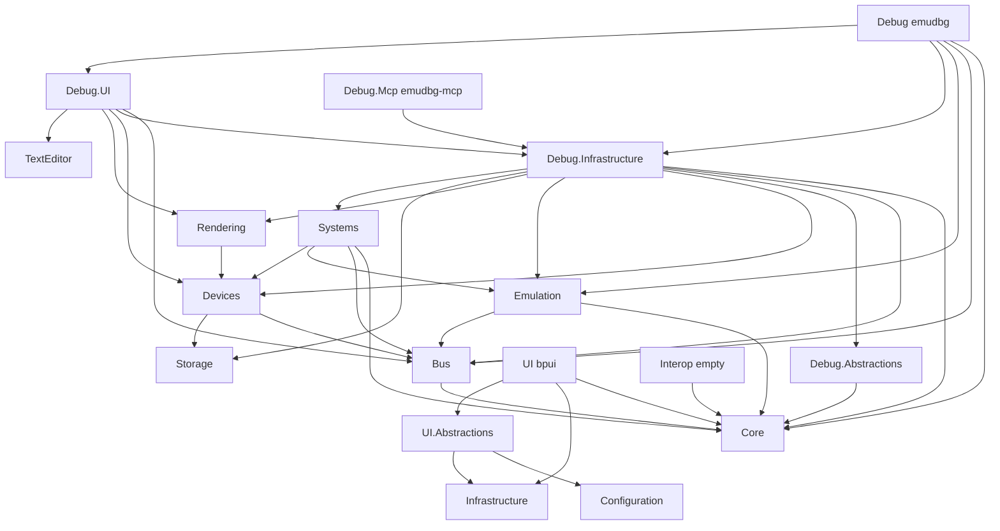

# Solution Consolidation Design

Design for #478, under epic #477. This file is the layout. It does not move code, delete code, or add a project.

Inventory taken at `18cde56` (2026-11-18), which is `main` after Debug.Mcp landed. The 2026-11-16 snapshot in #477 (17 src assemblies, no Debug.Mcp) is superseded by the tables below.

Binding order is #477's "Agreed sequencing (Josh, 2026-11-16)":

1. This design is doc-only. Debug.Mcp (#338) has already landed. Storage.FileSystems (#341) has not, and it lands in the place named here. Deleting the empty Interop project is already #555 and can proceed now.
2. Finish #373 and #276–#287 before any consolidation move. #287 removes the legacy closure dispatch path. That path is out of scope here.
3. One area per PR, `git mv` plus project-file changes only, no logic edits, namespaces unchanged. Debug.\* merges after #337 (merged). Devices and Rendering stay as they are through the keyboard (#388) and video (#405) work; the checkpoint after #395 and #409 is when a Devices/Rendering move would have run, and this design does not run one.
4. #374 and #414, then the module host (#473), start on the layout below.

#473's host categories are the seams: CPU cores, bus devices, slot cards, firmware and trap handlers, display and audio sinks, debugger extensions. This epic does not extract the versioned host NuGet. It leaves assemblies those categories can sit on.

## 1. Current-state inventory

Counted by a script over every `*.csproj` under `src/` and `tests/`. "C# lines" is every physical line in `*.cs` under that project directory, including blanks and comments, excluding `bin/` and `obj/`. `src/Shared/CSharp15Polyfills.cs` (63 lines) is linked into every project from `Directory.Build.props` and is not included in any row. Package versions live in `Directory.Packages.props`. The script reads direct `ProjectReference` and `PackageReference` items only.

18 src projects, 91,470 C# lines. 15 test projects, 86,474 C# lines.

### Src

| Project | Output | Files | Lines | Project references | NuGet packages |
| --- | --- | ---: | ---: | --- | --- |
| Core | Lib | 64 | 6,537 | — | Serilog |
| Bus | Lib | 120 | 20,074 | Core | — |
| Emulation | Lib | 41 | 6,429 | Core, Bus | — |
| Devices | Lib | 104 | 14,570 | Bus, Storage | OpenTK.Audio.OpenAL, Serilog, Silk.NET.OpenAL.Soft.Native |
| Storage | Lib | 26 | 2,903 | — | — |
| Rendering | Lib | 9 | 1,988 | Devices | Avalonia |
| Systems | Lib | 2 | 734 | Bus, Core, Emulation, Devices | — |
| Configuration | Lib | 19 | 1,207 | — | Autofac, Microsoft.Extensions.Logging.Abstractions |
| Infrastructure | Lib | 3 | 193 | — | Autofac, Microsoft.Extensions.Logging.Abstractions |
| UI.Abstractions | Lib | 9 | 230 | Configuration, Infrastructure | — |
| UI (`bpui`) | WinExe | 45 | 3,259 | Core, Infrastructure, UI.Abstractions | Avalonia, Avalonia.Desktop, Avalonia.Themes.Fluent, Avalonia.Fonts.Inter, Avalonia.Skia, CommunityToolkit.Mvvm, Autofac, Autofac.Extensions.DependencyInjection, Microsoft.Extensions.Hosting, Microsoft.Extensions.Configuration, Microsoft.Extensions.Configuration.Json, Microsoft.Extensions.Configuration.EnvironmentVariables, Microsoft.Extensions.Configuration.CommandLine, Serilog, Serilog.Extensions.Hosting, Serilog.Settings.Configuration, Serilog.Sinks.Console, Serilog.Sinks.File |
| TextEditor | Lib | 6 | 889 | — | Avalonia, Avalonia.Desktop, Avalonia.Themes.Fluent, Avalonia.Fonts.Inter, Avalonia.AvaloniaEdit, AvaloniaEdit.TextMate, Autofac |
| Debug.Abstractions | Lib | 32 | 1,258 | Core | — |
| Debug.Infrastructure | Lib | 102 | 21,988 | Bus, Core, Debug.Abstractions, Devices, Emulation, Rendering, Storage, Systems | Autofac, Serilog |
| Debug.UI | Lib | 31 | 6,900 | Bus, Debug.Infrastructure, Devices, Rendering, TextEditor | Avalonia, Avalonia.Controls.DataGrid, Avalonia.Desktop, Avalonia.Themes.Fluent, Avalonia.Fonts.Inter, CommunityToolkit.Mvvm, Autofac |
| Debug (`emudbg`) | Exe | 4 | 362 | Core, Bus, Emulation, Debug.Infrastructure, Debug.UI | Autofac.Extensions.DependencyInjection, Microsoft.Extensions.Hosting, Serilog.Extensions.Hosting, Serilog.Sinks.Console, Serilog.Sinks.File |
| Debug.Mcp (`emudbg-mcp`) | Exe | 22 | 1,949 | Debug.Infrastructure | Autofac, Autofac.Extensions.DependencyInjection, Microsoft.Extensions.Hosting, ModelContextProtocol, Serilog, Serilog.Extensions.Hosting, Serilog.Sinks.Console, Serilog.Sinks.File |
| Interop | Lib | 0 | 0 | Core | — |

`BadMango.Emulator.Debug.Mcp` is in the tree: assembly name `emudbg-mcp`, stdio host, one project reference (Debug.Infrastructure). It does not reference Debug.UI.

Interop is a csproj and a README. No project references it. Removal is #555.

`bpui` does not reference Bus, Emulation, Devices, Systems, or Storage. The GUI shell is not the machine.

The solution also contains `benchmarks/BadMango.Emulator.Benchmarks` (16 C# files, 1,595 lines). It is outside `src/` and `tests/`. `BadMango.Emulator.Tests` references it for the workload-coverage tests. This epic does not move it.

### Tests

| Project | Files | Lines | Project references | NuGet packages |
| --- | ---: | ---: | --- | --- |
| Unit.Components | 6 | 432 | — | Moq, Newtonsoft.Json, Serilog |
| Bus.Tests | 63 | 22,241 | Unit.Components, Bus | Moq |
| Emulator.Tests | 47 | 23,241 | Benchmarks, Unit.Components, Bus, Core, Debug.Infrastructure, Devices, Emulation, Storage, Systems | Moq |
| Devices.Tests | 37 | 11,389 | Unit.Components, Core, Devices, Storage | Microsoft.CodeAnalysis.CSharp, Moq |
| Debug.Infrastructure.Tests | 50 | 13,157 | Unit.Components, Bus, Debug.Abstractions, Debug.Infrastructure, Storage | Autofac, Moq |
| Debug.Abstractions.Tests | 1 | 273 | Bus, Debug.Abstractions | — |
| Debug.Tests | 8 | 1,474 | Unit.Components, Debug | Autofac, Moq |
| Debug.UI.Tests | 15 | 3,240 | Unit.Components, Debug.Infrastructure, Debug.UI | Avalonia.Headless.NUnit, Moq |
| Debug.Mcp.Tests | 6 | 1,371 | Debug.Mcp, Unit.Components | Microsoft.Extensions.Hosting, ModelContextProtocol |
| Rendering.Tests | 10 | 3,102 | Unit.Components, Rendering | Moq |
| Storage.Tests | 7 | 1,266 | Unit.Components, Storage | Moq |
| Configuration.Tests | 3 | 654 | Unit.Components, Configuration | — |
| TextEditor.Tests | 7 | 1,067 | Unit.Components, Debug.Infrastructure, TextEditor | Avalonia.Headless.NUnit, Avalonia.Themes.Fluent, Avalonia.AvaloniaEdit, Moq |
| UI.Tests | 18 | 3,379 | Unit.Components, Configuration, Infrastructure, UI.Abstractions, UI | Avalonia.Headless.NUnit, Moq |
| Infrastructure.Tests | 1 | 188 | Unit.Components, Infrastructure | Moq |

`Emulator.Tests` is the cross-suite (CPU, machine, Systems, Core). `Debug.Abstractions.Tests` does not reference Unit.Components. Core, Emulation, and Systems have no test project of their own.

### Dependency graph

An arrow means "references".



Debug.Infrastructure is the hub: the MCP host reaches the machine only through it, and that chain includes Rendering, so a published `emudbg-mcp` already carries Rendering's Avalonia reference in its dependency closure. The moves below must not add Debug.UI or TextEditor to that chain.

## 2. Target assembly layout

Ten src assemblies, down from 18. The surviving project keeps its directory, csproj name, assembly name, and `RootNamespace`. Moved files keep the namespace they have today, so one assembly will contain several namespaces until a later rename. That rename is not part of #477.

| Assembly | Output | Contains | #473 seam |
| --- | --- | --- | --- |
| Core | Lib | Core + Bus + Emulation | CPU cores, and the bus they run on. Base CPU is `Cpu65C02`. Trap registration stays here with the bus. |
| Devices | Lib | Devices | Bus devices, slot cards, device ROMs (Disk II, Thunderclock, PocketWatch), speaker / OpenAL. |
| Storage | Lib | Storage | Media formats and, from #341, the read-only file-system readers. Leaf: no project references. |
| Rendering | Lib | Rendering | Display sink. `PixelBuffer` references Avalonia. |
| Systems | Lib | Systems | Machine composition. Pocket2e wires CPU, bus, and devices. A profile names what a machine includes. |
| UI (`bpui`) | WinExe | UI + UI.Abstractions + Infrastructure + Configuration | Host shell. Still does not reference the machine. |
| Debug.Infrastructure | Lib | Debug.Infrastructure + Debug.Abstractions | Debugger extensions. `IDebugSession` lives here. |
| Debug.UI | Lib | Debug.UI + TextEditor | Debugger windows and the editor they host. |
| Debug (`emudbg`) | Exe | Debug | Console host. Stays thin. |
| Debug.Mcp (`emudbg-mcp`) | Exe | Debug.Mcp | MCP host. Stays a separate process. |

### Why these boundaries

Core absorbs Bus and Emulation because the bus is the other half of the CPU. After the move, Core has no project reference. Devices continues to reference Core (today it references Bus). Systems references Core and Devices and drops Bus and Emulation. Folding Systems into Core would make Core reference Devices while Devices references Core.

Storage stays a separate leaf. Slot cards depend on media; media does not depend on cards. #374's readers then sit under the media assembly rather than inside the video and keyboard projects, which are busy until the #395 / #409 checkpoint.

Rendering stays a separate assembly. `PixelBuffer` uses `Avalonia.Media.Imaging.WriteableBitmap`. Folding Rendering into Devices would put that package on Devices, and Systems would take it with the Devices reference. Display output stays the Rendering assembly. Audio stays on Devices, where OpenAL already is.

The debugger is three projects because there are two processes and one shared library. Debug.Mcp's only project reference is Debug.Infrastructure. emudbg references Debug.Infrastructure and Debug.UI. Merging either host into the other would put Avalonia on the MCP process, or the MCP SDK on the console host. Debug.Abstractions (1,258 lines, referenced by the library and by tests) folds into Debug.Infrastructure. TextEditor is referenced only by Debug.UI and folds into it.

The host shell is four projects with a single production consumer (`bpui`). Infrastructure (193 lines), UI.Abstractions (230), and Configuration (1,207) fold into UI. Nothing else in `src/` references them.

### Where Debug.Mcp and Storage.FileSystems live

Debug.Mcp already lives at `src/BadMango.Emulator.Debug.Mcp`, assembly `emudbg-mcp`. That is its home. It is not merged into emudbg or bpui. After Debug.Abstractions folds into Debug.Infrastructure, the MCP csproj still has that one project reference.

#341 adds the file-system contracts to the existing Storage project. Namespace `BadMango.Emulator.Storage.FileSystems`. Directory `src/BadMango.Emulator.Storage/FileSystems/`. Tests go in `tests/BadMango.Emulator.Storage.Tests/`. No new csproj and no new solution entry. #341 can start once this design is accepted. It does not wait for the git-mv PRs, and it does not wait for the Devices/Rendering checkpoint.

### Test projects

Ten test projects, down from 15. A dedicated test project moves in the same PR as the production project it follows. `Emulator.Tests` is emptied by a later PR, after Bus and Emulation have folded into Core.

| Test project | Made from |
| --- | --- |
| Core.Tests | Bus.Tests, plus the Core / Bus / Emulation / Systems files from Emulator.Tests. Systems does not gain its own test project. |
| Devices.Tests | unchanged |
| Rendering.Tests | unchanged |
| Storage.Tests | unchanged. #341's fixtures go here. |
| UI.Tests | UI.Tests + Infrastructure.Tests + Configuration.Tests |
| Debug.Infrastructure.Tests | Debug.Infrastructure.Tests + Debug.Abstractions.Tests |
| Debug.UI.Tests | Debug.UI.Tests + TextEditor.Tests |
| Debug.Tests | unchanged (the emudbg exe) |
| Debug.Mcp.Tests | unchanged |
| Unit.Components | unchanged shared helper library |

Workload-coverage tests that `using BadMango.Emulator.Benchmarks` keep a project reference to the benchmarks project on whichever test project receives those files.

## 3. Dead code

A removal candidate meets all of these:

- The type or member name appears only in its declaring file, or only there and in a test that exists to mention it.
- It is not an extension container (`IntegerExtensions`, `RegisterHelpers`, `ProcessorStatusFlagsHelpers`). Call sites name the method.
- It is not discovered by reflection: REPL command types, Autofac modules, `[McpServerTool]` types.
- It is not a private nested type used in its own file.

"No references found" means a whole-word search of `src/` and `tests/` `*.cs` and `*.axaml`, excluding `bin/` and `obj/`.

### Out of scope

- Legacy closure dispatch: `OpcodeHandler`, `AddressingModeHandler`, the trampoline, and `OpcodeEntry.Legacy`. #285 and #286 are still open. #287 deletes that path. Do not delete it here.
- Interop. Already filed as #555.
- `IDisplaySwitchLog` and `IVideoWriteLog`. The file remarks say they are declared for the hot-side capture work and are not installed yet. That work is #409.
- `Cpu65816` and `Cpu65832`. Both throw `NotImplementedException` from `Step` and `Reset`. `Cpu65816` is constructed from a debug test. `Cpu65832` has no construction site. `CpuFamily` and `schemas/machine-profile.schema.json` still name both, and `MachineBuilder` rejects 65832 with `NotSupportedException`. #473's 65816 module replaces the placeholder later. Leave both classes, the enum, and the schema.
- `src/Shared/CSharp15Polyfills.cs` was compiled into every project at this inventory. The net11.0 retarget removed it; the net11.0 reference assemblies define the union and closed-hierarchy types the compiler needs.

### Remove

| Candidate | Evidence |
| --- | --- |
| `ConfigurationData` (`src/BadMango.Emulator.Core/ConfigurationData.cs`, 23 lines) | No references found. |
| `MemorySizes` (`src/BadMango.Emulator.Core/MemorySizes.cs`, 52 lines) | No references found. Call sites use raw sizes. |
| `WithMinimalCompositeIOHandler` on `Pocket2eMachineBuilderExtensions` | `[Obsolete]`. No callers. The body calls `RegisterCompositeIOHandler`. |
| `RegisterLanguageCardFactory(Func<MachineBuilder, IBusTarget>)` | `[Obsolete]`. No callers. `DeviceFactoryExtensions` calls the parameterless overload. The parameter is ignored. |
| `LanguageCardDevice.ConfigureMemory(IMemoryBus, IDeviceRegistry, IBusTarget)` | `[Obsolete]`. The only declaration is the method itself. The parameter is ignored. Call sites use the two-argument method or the builder callback. |

### Verify before removing

| Candidate | Evidence | Why it stays until someone checks |
| --- | --- | --- |
| Bring-up cluster: `IBringUpHandler`, `BringUpHandlerBase`, `IBringUpResult`, `BringUpResult`, `BringUpValidationResult`, `IProvisioningBundle`, `ProvisioningBundle`, `IMachineConstants`, and `BringUpHandlerTests` | Names appear only inside that cluster and the test. `MachineBuilder`, Systems, and Devices do not mention them. Machine construction is the profile builder. | Eight production files plus a test. Confirm nothing loads `IBringUpHandler` by reflection before deleting the set. |
| `ControlRegisterHelpers` (157 lines) | `GetPrivilegeLevel`, `IsPagingEnabled`, `GetAsid`, `IsNoExecuteEnabled`, and `GetInterruptPriority` appear only in that file. | This is the unused CR0 helper. The live `PrivilegeLevel` on `BusAccess` and `PageEntry` (unified in #535) stays. `SystemRegisters` is stored and not read by a running CPU. |
| `IVideoSession` | No references found. Pixels go through `PixelBuffer`, `Pocket2VideoRenderer`, and the Debug.UI video window. | #405 may still want a session type. |
| `StatusFlag` | No references found. Soft switches in use are `DisplaySwitch` and `ISoftSwitchProvider`. | #409 is the switch-log work. Confirm it does not want this enum. |
| `IDiskImageTooling`, `DiskImageCreationOptions`, `ITrackMedia`, `INibbleStreamMedia`, `IStorageControllerCard` | No implementer. `StorageAbstractionInterfaceTests` reflects on the shape. | #341's contract is `IAppleFileSystem`, which is a different type. These may still be the image-tooling plan. |
| `IVideoScanner<TState>` | The only implementer is the stub in `VideoContractTests`. | Video pipeline contract. Leave it for #405. |
| `AuxiliaryMemoryGeneralTarget` | Constructed only in `AuxiliaryMemoryControllerTests`. `Pocket2eMachineBuilderExtensions` constructs `AuxiliaryMemoryController` and does not construct this target. | Unwired aux-memory target, not an obvious leftover. |
| `BreakpointHitEvent`, `DisplayModeChangedEvent`, `MachineStateChangedEvent`, `WindowFocusRequestEvent` | Only `PopOutWindowIntegrationTests` publishes them. No production publisher. `bpui` does not reference the machine. | Reserved host-UI vocabulary. `ThemeChangedEvent` does have production callers and stays. |

The verify-before-removing production files are 1,361 C# lines. `BringUpHandlerTests` is another 241 lines and goes only if that cluster goes. The two Remove rows that are whole files are `ConfigurationData` and `MemorySizes` (75 lines). The other three Remove rows are members inside files that stay. None of these counts is a committed deletion.

`UI.Abstractions` grants `InternalsVisibleTo` to `BadMango.Emulator.UI.Abstractions.Tests`, and no such project exists. Drop that entry in the host-shell move.

## 4. Migration order

Rules for every move:

- One area, one PR, merged before the next move in that area opens.
- `git mv` of source files. The surviving csproj absorbs the moved project's `PackageReference` and `InternalsVisibleTo` items. The absorbed csproj and its solution entry are deleted. Project references to the absorbed project are retargeted at the survivor.
- No logic edits. Namespaces stay. On a filename collision (`GlobalUsings.cs`), rename the moved file and leave its contents alone. Extra global-using files still apply.
- Update the project tables in `CONTRIBUTING.md` and `MODULAR_STRUCTURE.md` in that PR. They already omit Debug.Mcp and Debug.Abstractions.
- Hold new assignments in that area while the PR is open.
- The test project that exists only to cover the absorbed assembly moves in the same PR. Splitting `Emulator.Tests` is its own PR.

Nothing in this list starts until #373 is closed and #287 has merged, except #555.

| Move | Area | Prerequisites | Risk |
| --- | --- | --- | --- |
| 0. Delete Interop | Interop | Already #555. Allowed now. | Low. No code and no references. The issue lists the doc lines to fix. |
| 1. Fold Infrastructure, Configuration, and UI.Abstractions into UI | Host shell (`bpui`) | #373 closed and #287 merged. Independent of keyboard and video. | Low. One production consumer. Copy `Microsoft.Extensions.Logging.Abstractions` onto the UI csproj (Autofac is already there). Merge Infrastructure.Tests and Configuration.Tests into UI.Tests. Drop the friend-assembly entry for the missing UI.Abstractions test project. Do not add a reference from UI to Bus, Devices, or Systems. |
| 2. Fold Debug.Abstractions into Debug.Infrastructure | Debugger library | Same gate. #337 is already merged. Do this before more debugger features land on the contract assembly. | Medium. `IDebugSession` changes assembly identity. In-repo callers are project references and get retargeted. Debug.Mcp's csproj stays a single reference to Debug.Infrastructure. Merge Debug.Abstractions.Tests into Debug.Infrastructure.Tests and keep that test project's Bus reference. |
| 3. Fold TextEditor into Debug.UI | Debugger UI | Same gate, plus a quiet point after #395 and #409. Debug.UI holds the video window and the glyph editor. | Medium. Headless Avalonia tests. Copy `Avalonia.AvaloniaEdit` and `AvaloniaEdit.TextMate` onto the Debug.UI csproj. Merge TextEditor.Tests into Debug.UI.Tests. emudbg stays the thin exe. |
| 4. Fold Bus and Emulation into Core | CPU and bus | #287 merged, so the closure-dispatch edits have landed in these files. Do not overlap #285 or #286. | High. Bus is the most referenced library (20,074 lines). After the move, Core has no project reference. Devices' Bus reference becomes Core. Systems keeps Core and Devices. Debug.Infrastructure, emudbg, and Emulator.Tests drop Bus and Emulation. Delete Core's `InternalsVisibleTo` for Emulation (same assembly). Friend entries for Bus.Tests and Emulator.Tests move onto Core until the test split. |
| 5. Empty Emulator.Tests | Tests | Move 4, and the 1:1 test merges from moves 1–3. | Medium. Move each file whole into the test project for its subject (Core.Tests for CPU, bus, emulation, and Pocket2e; Debug.Infrastructure.Tests for debugger files). Add project references the file needs, including Benchmarks for the workload-coverage tests. Delete Emulator.Tests when it is empty. |

There is no Devices-into-Rendering move and no Rendering-into-Devices move. At the checkpoint after #395 and #409, leave both projects in place. A later split that pulls `WriteableBitmap` out of `PixelBuffer` would be a logic change, and the move rule does not allow it.

Storage, Systems, emudbg, and Debug.Mcp do not move.

## 5. Metrics

| | Now (`18cde56`) | Target |
| --- | ---: | ---: |
| Src assemblies | 18 | 10 |
| Src C# lines | 91,470 | 91,470 across the moves. Moves do not delete lines. |
| Test projects | 15 | 10 |
| Test C# lines | 86,474 | 86,474 across the moves. |
| Benchmarks C# lines | 1,595 | unchanged, and still not a src assembly |

Interop going away (#555) takes the src count from 18 to 17 before the folds. The folds remove Bus, Emulation, Configuration, Infrastructure, UI.Abstractions, TextEditor, and Debug.Abstractions.

The dead-code review pile is 1,361 production lines, and 75 of the Remove lines are whole files. Publish size is dominated by Avalonia on `bpui` and, through Rendering, on `emudbg-mcp`'s closure. Neither changes because of these moves.

### Publish size and cold start

Not measured for the inventory. `global.json` requires SDK `11.0.100` (`rollForward`: `latestPatch`). The machine used for this inventory has SDK `10.0.403` only, so `dotnet publish` cannot start. `DISPLAY` was set, so a built `bpui` could have been timed. No number is invented here. The measurement is in Baseline (before consolidation) below.

Take the baseline once, on a machine with that SDK, before move 1:

```bash
dotnet publish src/BadMango.Emulator.UI/BadMango.Emulator.UI.csproj \
  -c Release -r linux-x64 --self-contained false -o /tmp/bpui-publish
du -sb /tmp/bpui-publish
```

Record the SDK version, the RID, `--self-contained false`, the directory byte count, and the size of `bpui.dll`. Cold start is a fresh process of that publish under a real display, timed until the main window is mapped. One sample. Write the command and the two numbers into the PR. `Avalonia.Headless` does not measure this. Repeat the same command after the host-shell fold and after the Core fold if a later issue wants the after number.

### Baseline (before consolidation)

Taken before move 1 on commit `eee9e57682f00944f3164b27405ec7db1dbe1c6f`. bpui shell only; bpui is not yet wired to the emulator core, so this excludes machine construction and boot.

```bash
dotnet publish src/BadMango.Emulator.UI/BadMango.Emulator.UI.csproj \
  -c Release -r linux-x64 --self-contained false -o /tmp/bpui-publish
du -sb /tmp/bpui-publish
```

| | |
| --- | --- |
| SDK | `11.0.100` (`dotnet --version`). `global.json` pins `11.0.100`, `rollForward` `latestPatch`. The 11.0 channel install resolved to that version. Runtime `Microsoft.NETCore.App 11.0.0`. |
| RID | `linux-x64` |
| `--self-contained` | `false` |
| Publish directory | `29913145` bytes (`du -sb /tmp/bpui-publish`, immediately after publish) |
| `bpui.dll` | `1973760` bytes (`stat -c %s`) |
| Cold start | `899` ms. First of three fresh processes of `/tmp/bpui-publish/bpui`, until a visible window named `BackPocket Emulator`, then `xwininfo` Map State `IsViewable`. The other samples were `879` ms and `1001` ms. |
| Display | Xvfb: `Xvfb :99 -screen 0 1600x1200x24 -ac +extension RANDR +render -noreset`. No physical display. Xorg is not installed, `/dev/dri` is absent, and the environment's `DISPLAY=:1` did not open. |
| CPU | `Intel(R) Xeon(R) Processor`, 4 cores (KVM guest) |
| Timing | `scripts/measure-bpui-coldstart.sh`. Polls `xdotool search --onlyvisible --name`. xdotool 3.20160805.1 `--sync` steps about 500 ms, so the script does not use `--sync`. |

The cold-start sample is the first of those three fresh processes. The publish output was already in the file cache.

## 6. Proposed sub-issues

Not filed. #555 already covers Interop and should not be refiled. Sizes are XS / S / M.

| Title | Scope | Size | Depends |
| --- | --- | --- | --- |
| Fold the host shell into bpui | Move 1. git mv Infrastructure, Configuration, and UI.Abstractions into UI, and their tests into UI.Tests. | S | #373 closed, #287 merged |
| Fold Debug.Abstractions into Debug.Infrastructure | Move 2. One debugger library. Debug.Mcp's project reference stays. | S | #373 closed, #287 merged |
| Fold TextEditor into Debug.UI | Move 3. Editor joins the debugger UI library. emudbg stays an exe. | S | #373 closed, #287 merged, and the quiet point after #395 and #409 |
| Fold Bus and Emulation into Core | Move 4. Retarget every Bus and Emulation project reference onto Core. | M | #287 merged |
| Empty Emulator.Tests onto the surviving test projects | Move 5. git mv files, then delete the cross-suite project. | M | The Core fold |
| Delete unreferenced helpers and superseded Language Card overloads | The five Remove rows in section 3. | XS | Stay off files #285–#287 and #409 are editing |
| Review the verify-before-removing list | The verify table in section 3. Delete a row only after the check in that row. | S | The deletion issue. Devices files wait for the video checkpoint. |
| Record the bpui publish and cold-start baseline | Section 5's command, run once, numbers written into the PR. | XS | A machine with the SDK pinned in `global.json` |
