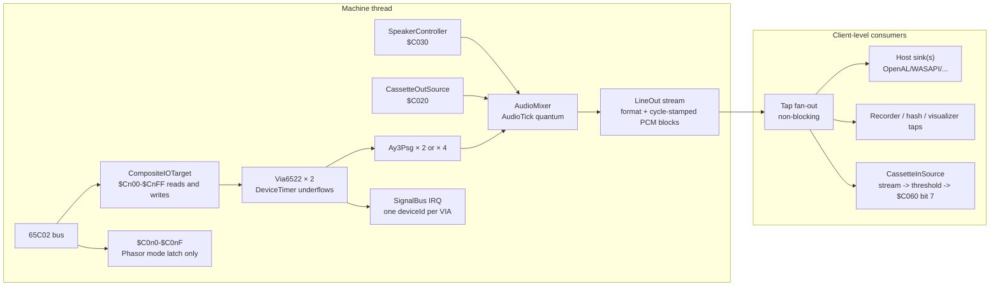

# Sound Card Specification

| Field | Value |
|---|---|
| Status | Draft for review |
| Owner | Josh |
| Tracking issue | #446 |
| Epic | #445 (Mockingboard and Phasor) |
| Baseline | `main` as of this document. No 6522, AY-3-8910, Mockingboard, or Phasor type exists in `src/`. |
| Related | #443 (clock rate, unthrottled, disk acceleration; its design is #444), `VIDEO-PIPELINE-PRD.md` (hot-thread and headless rules), `DISK-EMULATION-PRD.md` (slot cards, no shipped ROMs) |
| ROM policy | These cards have no firmware ROM. This epic ships none. Apple and third-party ROMs stay out of the tree. The repository's existing ROM bytes stay what they are: `pocket2-charset.rom` and the homebrew `boot.rom` from #437. |

---

## 1. Summary

Emulate the Sweet Micro Systems Mockingboard and the Applied Engineering Phasor so guest software can play music and sound effects, and so speech can be added later, without a vendor ROM.

The work splits into four devices that other cards can reuse:

1. A **6522 VIA** clocked by the bus cycle, with timers, ports, IFR/IER, and a level IRQ on `SignalLine.IRQ`.
2. An **AY-3-8910 / AY-3-8913** tone, noise, and envelope model. Register writes arrive through the VIA port protocol (BDIR, BC1, BC2 tied high).
3. A **host-independent line-out mixer** that folds the speaker and every PSG into one standard machine-owned PCM stream (`line out`) that host sinks consume as taps.
4. **Slot cards** (`mockingboard`, then `phasor`) installed through the existing profile and `ISlotCard` path. Default for the music profile is slot 4, which is where Ultima IV looks.

Detection is behavioral. Software pokes the 6522 and watches it count. Nothing in this epic plants signature bytes at `$Cn00`.

## 2. Normative language

The key words MUST, MUST NOT, SHOULD, SHOULD NOT, and MAY are used as in RFC 2119.

"Current behavior" means what `main` does at the baseline above. Those statements are descriptive. Requirements use MUST or SHOULD.

Where this spec and a later sub-issue of #445 disagree, this spec wins until Josh revises it. Appendix A lists the sub-issues. This document does not file them.

## 3. Problem

**The speaker is a motherboard device with its own host stream.** `SpeakerController` (`[DeviceType("speaker")]`) toggles on `$C030` through `IOPageDispatcher`, records `(cycle, state)` pairs where `state` is the bool level after the toggle, and synthesizes 16-bit mono PCM at a hardcoded 44 100 Hz. The decaying sample amplitude is a separate `double`, not that queued state. The cycle-to-sample conversion divides by `IMachine.ClockSpeedHz` when that value is greater than zero, and by `1_020_484` otherwise. A one-pole decay (`SpeakerDecayTimeConstantSeconds = 0.005`) pulls the cone back to silence. A 50 ms `System.Timers.Timer` calls `Flush()`, which hands a `short[]` to `IAudioOutput.Play`. The default constructor builds `OpenAlAudioOutput` and falls back to `NullAudioOutput` if OpenAL cannot start. Profile `config.sampleRate` (48000 on the checked-in Pocket2e profiles) is not read.

`OpenAlAudioOutput` is mono, 16-bit, three 1024-sample buffers, and a ring of `sampleRate * 200 / 1000` samples (8820 at 44.1 kHz, about 200 ms). Overrun drops the oldest samples. The playback thread is the only consumer. `IAudioOutput` extends `IDisposable` and its only playback method is `Play(short[])`. `Dispose` is the lifetime: `OpenAlAudioOutput.Dispose` cancels the playback thread and joins it (2 s timeout) before releasing the OpenAL device and context. `SpeakerController.Dispose` disposes that sink today, because the speaker constructed it.

**There is no standard machine-owned line-out contract yet.** The current path has no format descriptor object, no cycle-stamped block contract, no fan-out taps, and no policy for slow consumers beyond the OpenAL ring's own drop behavior. Cassette out (`$C020`) is not modeled as a mix source, and cassette in (`$C060` bit 7) does not yet consume the same stream shape from tape audio.

`ScheduledEventKind.AudioTick` exists. The speaker does not schedule it. Synthesis is driven by bus-access timestamps plus the wall-clock flush timer.

**Slots can publish a `$Cn00` window, and writes to that window are discarded.** `ISlotCard` exposes three regions: 16 bytes of device I/O at `$C0n0` (`SlotIOHandlers`, installed by `IOPageDispatcher.InstallSlotHandlers` at offset `0x80 + slot * 16`), a 256-byte `ROMRegion` at `$Cn00`, and an expansion ROM at `$C800`. `CompositeIOTarget.ReadSlotRom` forwards a read to `ROMRegion` when the card has one, and otherwise falls through to the motherboard CXROM so a Disk II with no P5/P6 image still hits the system firmware. `WriteSlotRom` selects the expansion slot and then returns. The bytes never reach `ROMRegion.Write8`. `RomTarget.Write8` already ignores ordinary writes, so forwarding writes is safe for real ROMs. A Mockingboard is not a ROM: every music driver stores the 6522 registers at `$Cn00` and `$Cn80`.

**IRQ is a wired-OR level the CPU samples at instruction boundaries.** `SignalBus.Assert` / `Deassert` take a `deviceId`. The line stays asserted while any id remains in that line's set. `SignalChanged` fires on the aggregate edge. `Cpu65C02.CheckInterrupts` consumes an NMI edge first, then samples `SignalLine.IRQ` as a level, masked by the I flag captured at the boundary (`irqMaskedAtBoundary`, so CLI/SEI/PLP take effect on the next instruction). No slot card asserts IRQ today. The keyboard asserts `SignalLine.Reset` only. A 6522 IRQ is also a level, held until the guest clears the flag, so the bus already has the right shape.

**Profiles put something else in slot 4.** `profiles/pocket2e.json`, `pocket2e-a2.json`, `pocket2e-a2-enh.json`, `pocket2e-lite.json`, and `pocket2e-devices.json` install `pocketwatch` in slot 4 and `disk-ii-compatible` in slot 6. `DeviceFactoryRegistry` discovers `[DeviceType]` and registers slot factories as `Func<MachineBuilder, JsonElement?, ISlotCard>`. The discovered factory ignores the JSON element. A card that needs configuration registers its own factory, the way a future Mockingboard factory must.

**Nothing in the debugger names a sound chip.** `emudbg` device commands live in `BadMango.Emulator.Debug.Infrastructure` behind `[DeviceDebugCommand]`. MCP tools are `load_profile`, `reset`, `step`, `run_until`, `pause`, `get_registers`, `read_memory`, `write_memory`, `disassemble`, `set_breakpoint`, and `set_watchpoint`. Speaker state is whatever a peek of `$C030` happens to do, and a side-effect-free peek does not toggle.

**#443 changes how fast cycles are produced.** Throttled `ClockSpeedHz` is both the run-loop delay and the speaker's pitch divisor. Unthrottled (`ClockSpeedHz == 0`) still synthesizes as if the clock were 1 020 484 Hz, then emits that PCM as fast as the host runs, and the 200 ms ring drops it. Disk-motor acceleration does not exist yet (#444 designs it). A PSG that naively shares the speaker path will screech or glitch for the whole of a fast disk load.

## 4. Goals

| # | Goal | Acceptance |
|---|---|---|
| G1 | A reusable 6522, clocked by bus cycles. | Timer 1 period is N+2 cycles in one-shot and free-run. IFR/IER, both ports, and IRQ match the register tests in §17. A second card can construct its own instances. |
| G2 | AY writes are cycle-accurate at the VIA pins. | A guest store sequence (latch, inactive, write, inactive) updates the addressed register on that cycle. A write that does not leave inactive first does not. |
| G3 | Music is audible in the existing host stream. | Speaker toggles and at least one PSG tone are summed into one 44.1 kHz mono stream. Headless tests record that stream with no OpenAL. |
| G4 | Ultima IV and Skyfox can see a card in slot 4. | A profile puts `mockingboard` in slot 4. A guest program that only touches `$C400` / `$C480` programs both VIAs. No ROM image is loaded. |
| G5 | Two cards at once. | Slots 4 and 5 each have a card. Clearing one VIA's IRQ leaves the other's IRQ on the bus. Both chips contribute samples. |
| G6 | Phasor mode switch. | Device-select accesses in `$C0n0–$C0nF` move the 3-bit latch among Mockingboard (000), native (101), and Echo+ (111). Reset restores the configured power-on mode. |
| G7 | Headless and deterministic. | Register tests and audio goldens run under `dotnet test` with no Avalonia, no OpenAL, and no Apple media. |
| G8 | Non-stock speed stays bounded. | A throttled clock other than 1.02 MHz keeps pitch locked to bus cycles. An unthrottled stretch, including a future #443 burst, does not overrun the ring. |
| G9 | Inspectable. | `emudbg` can dump VIA and PSG registers, mute a channel, and write a WAV. The same snapshot is what an MCP tool returns. |

## 5. Non-goals

- Shipping any Apple, Sweet Micro Systems, Applied Engineering, Votrax, or SSI ROM or disk image.
- A Mockingboard D or any IIc-external form factor. The slot model is the IIe `ISlotCard`.
- SC-01 / Votrax speech. Phase 5 is the SSI-263 only (§12.1). That phase is after the music card.
- A one-chip Sound I config. v1 is the two-VIA, two-PSG card.
- Band-limited (BLEP) synthesis in the first milestone. The exact renderer is the reference. A later renderer may sit beside it.
- Stereo at the host in v1. v1 sums left and right into the mono `IAudioOutput` the speaker uses. Stereo waits until the hash goldens exist. Per-channel mute still distinguishes the chips.
- Changing the speaker's decay model, the `$C030` toggle, or the meaning of `ClockSpeedHz`.
- Reading the profile `sampleRate` field. The mixer rate is 44 100 Hz. S11 deletes the unread key from the checked-in profiles.
- Replacing PocketWatch in the existing Pocket2e profiles. The music layout is a separate profile.
- Designing #444. This spec only says what the mixer does when the clock is zero or when a later acceleration window says "hold audio."
- Cycle-stretched Apple II long cycles (the 65th cycle). The machine's cycle is uniform. The VIA counts those cycles. See §9.2.

## 6. Users and scenarios

| Persona | Scenario |
|---|---|
| Player | A profile named for Ultima puts a Mockingboard in slot 4 and a Disk II in slot 6. The title's music driver finds the 6522s and plays. The internal speaker still clicks. |
| Player | The same profile is switched to a Phasor. Power-on mode is Mockingboard, so the same title still plays. A native-mode demo writes the mode latch and uses four PSGs. |
| Player | `ClockSpeedHz` is 4 MHz, throttled. Music plays higher and faster, in proportion to the clock, because the PSG is on φ2. A disk acceleration burst goes quiet and comes back on the current notes instead of dumping a backlog. |
| Developer | A test builds 40 bytes of 6502 in RAM, points the reset vector at them or sets PC, runs a fixed cycle count, and hashes the PCM. No file under `roms/` or `disks/` is required. |
| Developer at the REPL | `mb regs 4` prints both VIAs and both register files. `mb mute 4 A` silences one tone channel. IRQs keep firing. |
| Agent | Headless `emudbg` or the MCP host calls the same snapshot the REPL prints, and `mb record` writes a WAV under a sandbox root. |

## 7. Architecture

The hot thread does three small things for audio. It applies register writes on the bus access that caused them. It fires a VIA underflow from a `ScheduledEventKind.DeviceTimer` event, which updates IFR and the signal bus. It renders a quantum of PCM on `ScheduledEventKind.AudioTick` into a buffer the mixer already owns and publishes one line-out block. Host playback, recording, and visualization consume published blocks from taps outside the emulation core.

`Via6522` and `Ay3Psg` do not reference slots, profiles, or host audio APIs. The card owns the wiring between them. The mixer does not know what a 6522 is. It asks each `IAudioSource` for samples over a cycle range.

### 7.1 Standard line out and ownership (amends #606)

Every machine instance owns one `line out` stream. The stream contract is host-independent and machine-agnostic: it lives with core/devices and is reused by every machine type (#471), with one stream per machine instance.

The stream publishes fixed-size PCM quanta with:

- `AudioLineOutFormat`: sample rate, sample type, channel count, and channel layout metadata.
- `AudioLineOutBlock`: sample payload plus `[fromCycle, toCycle)` coverage in emulated time.

For v1, the format is 44 100 Hz, signed 16-bit PCM, mono. The contract MUST still carry channel count/layout so stereo is a format change, not an interface change (decision 16).

Ownership rules in #606 are reconciled as follows: the mixer owns line-out production; host sinks are subscribers (taps) registered by the client host (`emudbg`, `bpui`, MCP tools), not by speaker/sound-card/core device construction. The emulation thread MUST NOT block on tap delivery. A slow tap drops blocks and records a drop counter; emulation timeline progress wins over tap completeness.

Suggested types, all new unless named as existing:

| Type | Role |
|---|---|
| `Via6522` | Datasheet register file and timers. Raises or clears a caller-supplied IRQ. |
| `Ay3Psg` | 16 registers, tone, noise, envelope, logarithmic DAC. No bus of its own. |
| `AyBus` | BDIR / BC1 / /RESET edge protocol. The card calls it from the VIA port callback. |
| `MockingboardCard` | `ISlotCard`, `IResetReceiver`. Two VIAs, two PSGs. `[DeviceType("mockingboard")]`. |
| `PhasorCard` | Same shape plus the mode latch, four PSGs, and the native / Echo+ maps. `[DeviceType("phasor")]`. |
| `IAudioSource` | `Render(Span<int> into, Cycle from, Cycle to)` adding into a 32-bit mix. |
| `AudioLineOutFormat` | Host-independent stream descriptor (rate, sample type, channel count/layout). |
| `AudioLineOutBlock` | One PCM block plus covered emulated cycle range. |
| `IAudioTap` | Non-blocking subscriber for published line-out blocks. |
| `AudioMixer` | Owns line-out production and fan-out to registered taps. Sums sources. Implements speed policy in §11. |
| `IAudioOutput` | Legacy sink contract, adapted at the client boundary as one `IAudioTap` implementation. |
| `ISoundCardDebug` | Register snapshot, mute, line-out recording hook. |

`SpeakerController` grows an `IAudioSource` implementation and stops constructing `OpenAlAudioOutput`. Cassette out (`$C020`) is another `IAudioSource` mixed into line out. The machine builder creates one mixer when the profile has a speaker or a sound card, and the machine exposes one line-out stream per instance.

Host sinks (`OpenAlAudioOutput` today, others later) are attached by client-level composition as taps. Headless runs attach no host sink and still produce the same line-out blocks for tests and hash recording. `AudioMixer.Dispose` tears down stream publication state only; host sink disposal belongs to the client that attached the sink tap. `SpeakerController.Dispose` MUST NOT dispose shared line-out taps.

## 8. Bus placement

### 8.1 Where the registers live

Mockingboard drivers address the 6522s in the slot ROM window, not the 16-byte device-select window.

For a card in slot `n` (1–7), page base `B = $C000 + n * $100`:

| Addresses | Contents |
|---|---|
| `B+$00` through `B+$7F` | VIA 1. Register index is `address & $0F`. The 16 registers repeat eight times. |
| `B+$80` through `B+$FF` | VIA 2. Same index. |

`$C400` is VIA 1 ORB in slot 4. `$C480` is VIA 2 ORB. `$C410` is the same register as `$C400`. That mirror is what audit programs check, and it is part of G4.

The device-select window `$C0n0–$C0nF` is unused by a Mockingboard. A Phasor uses it only as the mode latch (§13). It does not alias the 6522 there.

### 8.2 Writes have to reach the card

`MockingboardCard.ROMRegion` returns a small `IBusTarget` whose `Read8` / `Write8` decode §8.1. `ExpansionROMRegion` stays null. `IOHandlers` stays null on the Mockingboard. The Phasor publishes `IOHandlers` for the mode latch and the same kind of `ROMRegion` for the VIAs.

`CompositeIOTarget.WriteSlotRom` MUST call `ROMRegion.Write8` with the low 8 bits of the offset when the installed card has a `ROMRegion`, and MUST still run the expansion-ROM select it runs today. When `ROMRegion` is null, behavior stays as it is (select, then ignore the data). `RomTarget` already drops ordinary writes, so Disk II and PocketWatch images do not become RAM.

`INTCXROM` still hides every slot window, reads and writes. `INTC3ROM` still hides slot 3. A card in slot 4 is reachable with the checked-in profiles, which set `internalCxRom` false. A test that turns `INTCXROM` on MUST see the card stop responding, and MUST see it respond again when the switch turns off.

Side-effect-free and debug reads (`BusAccess.IsSideEffectFree`, the same check the speaker uses for peek) MUST return the register value and MUST NOT clear IFR, decrement a timer, or strobe the AY. A debug poke is a real write: the user asked the machine to store.

Reads of a present card MUST NOT fall through to the motherboard CXROM. The card's target covers all 256 bytes. An empty slot still falls through, which is what makes `PR#6` work today.

### 8.3 No firmware

`LoadSlotCardRoms` looks for `config.rom` and reflects `LoadBootRom(byte[])`. The Mockingboard and Phasor factories MUST NOT implement that hook. A profile that sets `config.rom` on these types MUST fail the build with a message that names the slot. There is nothing to load, and a silent ignore would hide a mistake.

## 9. 6522 VIA

The model follows the Rockwell / WDC R6522 datasheet (registers, timer modes, IFR/IER write rules, handshake flags). Cycle counts that the datasheet leaves as a timing diagram are fixed here by the rule audit programs measure on real cards: timer 1's period is N+2 bus cycles (tomcw, `mb-audit`, "Timer1's period is N+2"). Implementers cite those documents. They do not port another emulator's VIA.

### 9.1 Registers

Index is `address & $0F` inside a VIA's half-page.

| Index | Name | Read | Write |
|---|---|---|---|
| 0 | ORB / IRB | Pin levels (outputs show the output latch) | Output latch. Calls the port-B listener. |
| 1 | ORA / IRA | Port A, with the datasheet handshake clear | Output latch, with handshake. |
| 2 | DDRB | Direction, 1 = output | Direction. |
| 3 | DDRA | Direction | Direction. |
| 4 | T1C-L | Live counter low. Clears the T1 interrupt flag. | T1 latch low. Does not start the timer. |
| 5 | T1C-H | Live counter high. | Latch high, load the counter from the latches, clear the T1 flag, arm the timer. |
| 6 | T1L-L | Latch low | Latch low. A free-running timer picks this up on the next reload. |
| 7 | T1L-H | Latch high | Latch high. Does not start the timer and does not clear the flag. |
| 8 | T2C-L | Live counter low. Clears the T2 flag. | T2 latch low. |
| 9 | T2C-H | Live counter high. | Latch high, load, clear the T2 flag, arm. |
| 10 | SR | Shift register | Stored. v1 does not shift. |
| 11 | ACR | Auxiliary control | Stored. Bits 6–7 control T1, bit 5 controls T2. |
| 12 | PCR | Peripheral control | Stored. |
| 13 | IFR | Flags. Bit 7 is set when any enabled flag in bits 0–6 is set. | A 1 in a bit clears that flag. Bit 7 is ignored. |
| 14 | IER | Bit 7 reads as 1. Bits 0–6 are the enable mask. | Bit 7 set: OR bits 0–6 into the mask. Bit 7 clear: clear those bits. |
| 15 | ORA / IRA | Port A without handshake side effects | Output latch without handshake. |

Port pins that are inputs read as 1 in v1 (the Mockingboard ties the AY data bus, and undriven inputs on these cards sit high). The reusable VIA takes an optional input sampler so a later card can feed real pins. The Mockingboard does not.

Reset (`IPeripheral.Reset` and `IResetReceiver.OnResetAsserted`) clears IER, IFR, ACR, PCR, the shift register, both DDRs, and both output latches, disarms both timers, and deasserts this VIA's IRQ if it was the one holding it. AY reset is a separate pin (§10) and also runs here so a card reset silences the PSGs.

### 9.2 Clock

One φ2 is one `IScheduler` cycle. The VIA does not read wall time and does not read `ClockSpeedHz`. The CPU, the timer, and the AY share that cycle. The Apple II "long cycle" is not modeled; both the CPU and the VIA run on the uniform cycle, so music written against the 1 020 484 Hz average stays in the same relationship to instruction timing that the rest of the machine has.

Timers are not polled. On arm, the VIA schedules one `DeviceTimer` event at the underflow cycle and cancels it if a later write disarms or reloads the counter. A read of T1C or T2C computes the live count from `dueCycle - scheduler.Now` and the latches, so a mid-count read is correct without a per-cycle tick. The scheduler is single-threaded on the machine thread. The VIA does not touch it from the OpenAL thread.

### 9.3 Timer period

Let N be the 16-bit value loaded into the counter (the latches at the write to TxC-H).

- The underflow, the IFR flag, and a free-run reload happen N+2 cycles after that write.
- Free-run (ACR bit 6 set) reloads from the latches and sets the flag every N+2 cycles until the timer is stopped or ACR changes.
- One-shot (ACR bit 6 clear) sets the flag once. The counter keeps decrementing. A later read still sees that count. The flag does not set again until the guest writes TxC-H.
- ACR bit 7 (T1 drives PB7) toggles or pulses PB7 on the same cycle as the flag, per the datasheet. PB7 output is visible to the port listener. Mockingboard music does not need the pin; the reusable core still implements it.
- T2 one-shot matches T1's N+2 rule. ACR bit 5 (count PB6 pulses) is part of the reusable core and has a unit test. The Mockingboard does not pulse PB6.

A latch of `$0000` underflows in 2 cycles. A latch of `$FFFF` underflows in 65537 cycles. Tests cover both ends and a value music actually uses (for example `$1A00`, which at 1 020 484 Hz is a bit under 60 Hz of interrupts).

### 9.4 IRQ

IFR bit 7 is `(IFR & IER & $7F) != 0`. On each transition of bit 7 the VIA calls its listener with the new level and the cycle.

The card gives each VIA its own `deviceId` and connects the listener to `ISignalBus`:

- Level asserted: `signals.Assert(SignalLine.IRQ, viaId, cycle)`.
- Level cleared: `signals.Deassert(SignalLine.IRQ, viaId, cycle)`.

Ids are unique among IRQ sources on that machine. Two VIAs on one card and two cards in one machine are four ids. The line stays asserted until every id has deasserted, which is the bus's existing wired-OR. The 6502 samples the level at the next instruction boundary. A flag that sets and clears inside one instruction is still visible to a poll of IFR; it vectors only if the line is up when the boundary runs. That matches the CPU we have.

The card does not install an interrupt handler, does not write `$FFFE`, and does not care whether the guest ROM's IRQ vector is present. Games that use the card ship their own vector.

Shift-register interrupts, CA1/CA2, and CB1/CB2 exist in IFR/IER so a guest that enables them and then polls sees a clear flag. v1 does not generate those flags from pin edges, except PB7 as part of T1. Speech (§12) is what first drives CA1.

## 10. AY-3-8910 synthesis

The chip model follows the General Instrument AY-3-8910 / AY-3-8913 datasheet: 16 registers, three tone channels, one noise generator, one envelope, the mixer, and the logarithmic DAC. The 8913 is the 8910 without the two general-purpose ports. Mockingboard cards are wired as 8910s or 8913s depending on the revision; nothing in the music path reads the AY's own I/O ports. Those registers (14 and 15) store a byte and do not affect audio.

### 10.1 Registers

| Register | Function |
|---|---|
| 0, 1 | Channel A period, 12 bits (fine, coarse). |
| 2, 3 | Channel B period. |
| 4, 5 | Channel C period. |
| 6 | Noise period, 5 bits. |
| 7 | Mixer. Bits 0–2 mute tone A–C when set. Bits 3–5 mute noise A–C when set. Bits 6–7 are the unused I/O directions. |
| 8, 9, 10 | Amplitude. Bits 0–3 are the level. Bit 4 selects the envelope instead of the level. |
| 11, 12 | Envelope period, 16 bits. |
| 13 | Envelope shape. A write retriggers the envelope from the start of the shape. |
| 14, 15 | I/O ports. Stored, not synthesized. |

Tone frequency is `clock / (16 * period)`. Noise frequency is `clock / (16 * period)`. Envelope frequency is `clock / (256 * period)`. On a Mockingboard, `clock` is φ2, the same cycle as §9.2. In Phasor native mode, `clock` is 2 × φ2 for the PSGs only (§13). The 6522 stays on φ2 in every mode.

Period 0 is defined as period 1 for tone, noise, and envelope. The datasheet's formulas start at 1, and this choice avoids a stuck or infinite counter. Josh confirmed this on 2026-11-19 (decision 4).

Envelope shapes are the datasheet's 4 bits: Continue (bit 3), Attack (bit 2), Alternate (bit 1), Hold (bit 0). All 16 values are implemented, including the ones that repeat a single shape. A write to register 13 restarts the shape even when the value did not change.

### 10.2 Amplitude

The DAC is the 16 logarithmic steps in the GI datasheet's D/A section, normalized into the mixer's integer domain. The implementation derives the table from that datasheet, checks the 16 values in with a comment that names the datasheet table, and tests that step 0 is silent and that each later step is greater than the one before it. Tables copied from another emulator are not a source.

### 10.3 Port protocol

BC2 is tied high on these cards. Port A is the 8-bit data bus. Port B drives the control pins. Only bits the DDR marks as outputs drive a pin. A bit left as an input does not change BDIR, BC1, or /RESET.

| PB2 | PB1 | PB0 | Name | Effect |
|---|---|---|---|---|
| 0 | x | x | Reset | Hold the AY in reset. Registers read as 0 and audio is silent. |
| 1 | 0 | 0 | Inactive | Bus idle. |
| 1 | 0 | 1 | Read | AY drives the current register onto port A. |
| 1 | 1 | 0 | Write | AY stores port A into the latched register. |
| 1 | 1 | 1 | Latch | AY latches the register index from port A, masked to 4 bits. |

PB2 is /RESET: low resets, high runs. The programming sequence every title uses is the one in the Mockingboard mini-manual: store the index at ORA, store `$07` at ORB (latch), store `$04` (inactive), store the data at ORA, store `$06` (write), store `$04` again. `$00` at ORB is a reset. DDR initialization is `$FF` at both DDRs, or `$07` at DDRB when the driver only cares about the three control bits.

A latch, write, or read is recognized on the transition into that function from inactive. Holding latch while the data bus changes does not re-latch. A write that is not preceded by inactive is ignored. This is the sequence the mini-manual requires, and it is the behavior real cards show when the lines do not pass through inactive (the case AppleWin recorded as GH#320). Reset (PB2 low) applies immediately, from any state, and it resets every AY attached to that VIA, including both chips of a Phasor pair.

A read function places the register value onto the port A input sampler, masked by the complement of DDRA, so bits the guest is driving stay driven by the guest. Cards that do not support AY reads (not our Mockingboard) are out of scope. Our chips do support reads. Detection and `mb-audit` depend on that.

### 10.4 Exact renderer

v1 renders the digital output, not a band-limited reconstruction.

The renderer keeps an integer phase for each tone counter, the noise LFSR, and the envelope counter. Over one host sample it advances those counters by the exact number of chip clocks that fall in that sample, using the same remainder trick `SpeakerController` uses (`cycle * sampleRate + remainder` divided by clocks-per-second). The sample value is the sum of the three channels' DAC levels at the end of that step, zero-order held. Square edges alias. That alias is the v1 sound. It is deterministic.

The noise LFSR is the 17-bit polynomial described in the datasheet's noise section (the bit that feeds back is the documented one). The seed after reset is fixed (all ones) so two runs hash the same.

A band-limited renderer MAY be added later behind the same register state, with its own golden. It does not replace the exact renderer, and the exact hash remains the accuracy check. v1 does not build it.

### 10.5 What "cycle-accurate writes" means

The mixer renders in quanta (§11), not per cycle. A register write that lands mid-quantum still takes effect on its cycle. The source records a short list of `(cycle, register, value)` changes since the last quantum, and the renderer applies each one at the sample that contains that cycle. A quantum with no writes advances phase only. The list is bounded: if a guest writes faster than the quantum can drain, the renderer flushes early. It does not drop writes.

Timer IRQs are not delayed to the quantum. They fire from `DeviceTimer` on their cycle (§9).

## 11. Mixing, line-out format, latency, and speed

### 11.1 Stream contract

`AudioMixer` produces one host-independent line-out stream per machine. The stream contract is `AudioLineOutFormat` + `AudioLineOutBlock` (`short[]` payload plus `[fromCycle, toCycle)` stamp). v1 format is 44 100 Hz, signed 16-bit PCM, mono. The format descriptor MUST include channel count/layout so a later stereo rollout does not require an interface change.

### 11.2 Tap fan-out and back-pressure

The mixer publishes each quantum to zero or more `IAudioTap` subscribers (host sink, WAV recorder, golden/hash recorder, visualizer, cassette input threshold path). Tap delivery MUST be non-blocking for emulation. If a tap cannot keep up, that tap drops older blocks and updates a drop counter; emulated cycle progression and source state updates continue with no stall.

The OpenAL backend is one tap attached by `emudbg`/`bpui` composition and is not owned by core devices. Headless runs attach no host sink.

### 11.3 One stream

The speaker's decay model is unchanged. Its step is `2 * SpeakerAmplitude` (16384) and then it decays. Each AY channel adds its normalized DAC level. Full scale for one channel (level 15, tone enabled, the other channels muted) SHOULD land near ±8192, so one voice sits under a hard speaker toggle. Three channels of one chip sum to about ±24576 and still fit in a `short`. A second chip, or the speaker step on top of a full chip, can exceed ±32767. That overflow is clamped once, at the end, and the mix before the clamp is 32-bit. The scale constant lives next to the DAC table and has a test. There is no per-card volume in v1.

Left and right chips both add at full scale. Mute (§16) zeros a channel before the add, so a muted chip still runs its counters and its IRQ.

### 11.4 Quantum and latency

The mixer schedules `AudioTick` on a fixed host-sample quantum: 441 samples, which is 10 ms at 44.1 kHz. That sample count does not change with `ClockSpeedHz`. What changes is how many bus cycles those 441 samples cover. The pitch divisor is `ClockSpeedHz` when it is greater than zero, else `1_020_484`, the same split `SpeakerController.GetCyclesPerSecond` uses. At the nominal clock a tick spans about 10 205 cycles. At a throttled 4 MHz it spans about four times that many cycles, so the same latch sounds higher, and each tick is still 10 ms of host audio. Wall-clock latency stays put because the ring is filled in sample time, not in bus-cycle time. The tick runs on the machine thread, renders, and enqueues.

The OpenAL ring SHOULD shrink from 200 ms to about 60 ms (three quanta plus one buffer of slack) so a register write is audible in under 100 ms at 1×. The three 1024-sample AL buffers stay. End-to-end target at 1× is ≤ 100 ms. The speaker's 50 ms `System.Timers.Timer` goes away once the mixer tick is flushing it; the decay math does not change, and the existing sample-count tests keep passing because they drive `Flush` themselves.

`AudioTick` does no work when nothing is playing and no consumer is recording: a silent, idle PSG and a resting speaker produce a single zero quantum and then the mixer stops scheduling until the next toggle or register write. That is the same "no consumer, no work" idea the video pipeline uses, applied to a much cheaper tick.

### 11.5 Throttled non-stock clocks

`#443` allows a throttled clock other than 1.02 MHz (Zip-style 2.8 or 4 MHz, or a custom value). The VIA and the AY keep counting bus cycles. The mixer's divisor is `ClockSpeedHz` when it is greater than zero, matching `SpeakerController.GetCyclesPerSecond`. A song whose timer latches were computed for 1.02 MHz plays proportionally faster and higher. That is what the same card does on a real accelerator: φ2 is the card's clock. v1 does not pitch-correct back to 1.02 MHz.

### 11.6 Unthrottled and disk acceleration

When `ClockSpeedHz` is 0, the machine runs as fast as the host allows. Synthesizing every cycle into the ring would overrun it and play garbage, which is what the speaker can do today.

While the clock is 0, the mixer MUST NOT enqueue. It drops the cycle range, leaves PSG and speaker phase where a single "advance to now, discard samples" step puts them (state stays coherent, audio does not backlog), and enqueues again on the first quantum after the clock is non-zero. The listener hears silence for the burst and then the notes that are current, with no catch-up glissando.

`#444` will add a window that accelerates while a Disk II motor is on and then restores the profile clock. The mixer treats that window the same way, behind a flag the speed epic sets (`IAudioMixer.HoldPlayback`). Until that flag exists, only `ClockSpeedHz == 0` holds playback. This epic does not detect the Disk II motor.

A test sets the clock to 0, runs a pure tone for a large cycle count, and asserts the recording sink received no samples. A second test sets 2 040 968 Hz, runs the same latch, and asserts the rendered frequency doubled.

## 12. Mockingboard variants

All of these are slot cards with no ROM. v1 implements the row marked in the table. The others are named so a profile string does not get invented twice.

| Variant | 6522 | PSG | Speech | v1 |
|---|---|---|---|---|
| Sound I | 1 | 1 × AY-3-8910 | Optional SC-01 on the same VIA | No. Josh, 2026-11-19: no one-chip config. |
| A / Sound II | 2 | 2 × AY-3-8910 or 8913 | None | Yes. This is the music card. |
| C | 2 | 2 × AY-3-8913 | SSI-263 | Music path yes. Speech is phase 5. |
| D | IIc external, not an IIe slot | Same idea as C | SSI-263 | No. |
| Phasor | 2 | 4 × AY-3-8913 | Up to two SSI-263 | Phase 4, §13. |

The v1 `[DeviceType("mockingboard")]` card is the two-VIA, two-PSG card. It is what Ultima IV's music, Ultima V's music, and Skyfox drive. Speech chips are not constructed. Writes that a C-series title aims at an SSI-263 alias (§13 notes the Phasor alias; on a plain Mockingboard the SSI-263, when present, is selected by extra port-B decoding on top of the same 6522s) fall through to the VIA register they overlap, which is what a card without the speech socket does.

### 12.1 Speech, later

Phase 5 adds an optional SSI-263 on the C and on the Phasor. There is no SC-01 and no Votrax. Josh, 2026-11-19. The SSI-263 is a phoneme synthesizer. Its IRQ is wired to the 6522 CA1 (the Mockingboard C path titles already use: PCR and IER bit 1 on the second VIA) and, on the Phasor, also directly onto the card IRQ. That direct wire is a third `deviceId` on `SignalLine.IRQ`. None of this is required for G4.

The speech phase still ships no ROM and no phoneme table taken from a vendor disk. The phoneme audio model, if it is more than "the registers exist and IRQ toggles," is its own design note inside that issue.

## 13. Phasor

The Phasor is a different card type, not a mode bit on `mockingboard`. It has two 6522s and four AY-3-8913s (two per VIA). Power-on and reset load a 3-bit mode latch from configuration. The default configuration is Mockingboard mode, so a Phasor in slot 4 passes the same Ultima IV / Skyfox checks as §12.

### 13.1 Mode latch

The latch sits on the slot device-select window. For slot 4 that is `$C0C0–$C0CF`. Any access, read or write, with low nibble `M` does:

1. If bit 3 of `M` is set, clear the latch to 000.
2. OR the latch with bits 2–0 of `M`.

The encoding, from the hardware notes on real cards (AppleWin's record of those experiments, issues #1183 and #1197, and the Phasor mini-manual's DIP modes):

| Latch | Mode | How a slot-4 program gets there from a known state |
|---|---|---|
| 000 | Mockingboard | Reset, or a read of `$C0C8` (bit 3 set, low bits clear). |
| 101 | Native | From 000, a read of `$C0C5`. From any mode, `$C0C8` then `$C0C5`. |
| 111 | Echo+ | From 000, a read of `$C0C7`. From native (101), a read of `$C0C2` (OR in bit 1). |
| other | Reserved | The raw bits stick. PSG routing stays on the Mockingboard map until the latch becomes 000, 101, or 111. |

`$C0C5` from Echo+ (111) stays on Echo+, because bit 3 is clear and the OR does not knock bits off. That is why the same address is documented as "native" from reset and "still Echo+" afterwards. The test table includes both.

Reset and power-on set the latch to the configured mode, not unconditionally to 000. The default configuration is 000, which matches a Phasor whose DIP is in the Mockingboard position and matches the observed reset behavior when that is the switch setting. A profile that wants native at power-on sets the config. The DIP switches for speaker-passthrough volume are analog and out of scope.

### 13.2 Routing

Control pins are the same port-B assignment as §10.3 in every mode. Chip select uses PB4 and PB3, and only when the mode looks at them.

**Mockingboard mode.** Address decode is §8.1. PB4 and PB3 are ignored. Each VIA talks to its first AY only. The second AY on that VIA stays silent. A title that writes both `$Cn00` and `$Cn80` therefore gets two channels, one per VIA. A title that writes only one VIA gets one channel, which is what a real Phasor does with the Echo+ demo while the latch is still in Mockingboard mode. Our Mockingboard card has one AY per VIA, so the same stores produce the same number of audible channels.

**Native mode.** PSG clock is 2 × φ2. 6522 clock stays φ2. Address bit 7 and bit 4 choose which VIA is selected, and both can be selected on one access:

| A7 | A4 | VIAs selected |
|---|---|---|
| 0 | 0 | Neither. Read returns `$FF`. Write does not change a VIA. |
| 0 | 1 | VIA 1 |
| 1 | 0 | VIA 2 |
| 1 | 1 | Both, same register index (`address & $0F`) |

Chip select is active low: PB4 low selects the first AY on that VIA, PB3 low selects the second. Both low writes both. A write with neither selected changes no register. /RESET (PB2 low) resets both AYs on that VIA regardless of PB4 and PB3.

**Echo+ mode.** One 6522 image is mirrored at every 16-byte boundary in `$Cn00–$CnFF` (the card's second VIA, matching the Echo+ "single 6522, two AYs" layout). Chip select is active high and swapped relative to native: PB3 high selects the first AY, PB4 high selects the second. Both high writes both. /RESET still clears both. PSG clock is φ2, same as Mockingboard mode.

Speech-chip address windows (`$Cn2x`, `$Cn4x`, `$Cn6x` on the real Phasor) are not decoded in phase 4. Those addresses follow the tables above, so a native-mode access with A4 clear and A7 clear reads `$FF`. Phase 5 inserts the SSI-263 into those windows and stops the VIA from claiming them.

### 13.3 Mode changes mid-note

Switching mode does not reset the AY registers. It changes which address hits which chip and, for native mode, the PSG clock from the next sample onward. A test latches a tone in Mockingboard mode, switches to native, and sees the frequency double without a second register write.

## 14. How software finds the card

There is no ID byte and no slot ROM. A successful probe is "this page behaves like a 6522."

Programs that matter for G4:

- **Ultima IV** looks in slot 4. The music profile puts the card there. The spec takes that from #445. A test does the same stores a detector does: write DDRA/DDRB, start T1 with a known latch, read T1C-L a known number of cycles later, and require the count to have moved. A slot whose `ROMRegion` is a ROM image fails that test, because a ROM does not count.
- **Ultima V** uses the same two-VIA layout for music, and the SSI-263 for speech. Music is in scope. Speech is phase 5.
- **Skyfox** uses the Mockingboard for effects and finds it by the 6522, in slot 4 in the configuration #445 calls out. The same probe test covers it.
- Scanners (the pattern `mb-audit` and several demos use) walk slots 1–7, try `$Cn00` and `$Cn80`, and accept a slot whose timer runs. Two installed cards are both found. An empty slot falls through to CXROM and fails the probe, which is the correct negative.

The probe test runs with `INTCXROM` off. It uses guest stores through the bus, not a backdoor into `Via6522`, so a regression in §8.2 fails it.

No test in this epic loads Ultima, Skyfox, or any other commercial disk. The probe sequence is reimplemented in the test from the behavior above.

## 15. Profiles and slots

### 15.1 Factory

`[DeviceType("mockingboard")]` and `[DeviceType("phasor")]` are discovered by `DeviceFactoryRegistry` the same way `pocketwatch` is. The discovered factory ignores JSON. `RegisterStandardDeviceFactories` MUST install an explicit `RegisterSlotCardFactory` for each type that overwrites the discovered one and reads `config`.

Mockingboard `config` keys:

| Key | Default | Meaning |
|---|---|---|
| `powerOnMode` | rejected if present | Not a Phasor. |
| `rom` | rejected if present | §8.3. |

Phasor `config` keys:

| Key | Default | Meaning |
|---|---|---|
| `powerOnMode` | `"mockingboard"` | `"mockingboard"`, `"native"`, or `"echo-plus"`. |
| `rom` | rejected if present | §8.3. |

Unknown keys MUST fail the build with the slot number in the message. A missing `config` object means defaults.

### 15.2 Where slot 4 goes

The checked-in `pocket2e*.json` profiles keep PocketWatch in slot 4. A new profile, `profiles/pocket2e-mockingboard.json`, is a copy of `pocket2e.json` with slot 4 set to `mockingboard` and PocketWatch moved to slot 5. Slot 2 stays empty so a serial card can go there later. Slot 6 stays `disk-ii-compatible`. That is the Ultima IV layout. Josh, 2026-11-19.

A second example, in that profile's comments or in a second profile if a comment is the wrong place for a worked example, adds a `phasor` in slot 1 with `powerOnMode` native next to the slot 4 Mockingboard. Slot 5 stays PocketWatch. The schema and `specs/reference/Machine Profile Configuration Guide.md` gain the two types when the profile issue lands. This document is the contract for those edits.

Installing both a Mockingboard and a Phasor is legal. Installing two of either is legal, up to the seven slots. Slot 0 stays the language card and is rejected by `SlotManager` as it is today.

### 15.3 Multiple cards and the mixer

Each card adds its PSGs as `IAudioSource`s during `Initialize`. Order is slot order, so the mix is deterministic. IRQ ids do not depend on construction order beyond "unique." Removing a card is a rebuild; v1 does not hot-unplug.

## 16. Debugger and MCP

Device commands stay in `BadMango.Emulator.Debug.Infrastructure` with `[DeviceDebugCommand]`, which is where `pwtime` and the disk commands live. The device assembly exposes `ISoundCardDebug` on the card and `IAudioMixer` recording on the mixer. The command handler resolves them from the machine. It does not poke `$Cn00` to read state, because a read of T1C-L clears a flag.

### 16.1 `mb` command

`mb` with no arguments lists every sound card: slot, type, Phasor mode, whether playback is held (§11.6).

`mb regs <slot>` prints, for that slot, both VIAs (ORB, ORA, DDRB, DDRA, T1 counter, T1 latch, T2 counter, T2 latch, ACR, PCR, IFR, IER, IRQ level) and every PSG (16 registers, current index, reset pin, envelope step). Hex, one block per chip.

`mb mute <slot> <target>` and `mb unmute <slot> <target>`. `target` is `all`, a chip (`1` or `2`, and `3` or `4` on a Phasor), or a channel (`1A`, `1B`, `1C`, …). Mute is host-side. Guest-visible registers do not change. IRQs do not change.

`mb record <path> [--cycles=N]` runs N emulated cycles (default 1 020 484, one nominal second, capped at 5 seconds) and writes a 44.1 kHz 16-bit mono WAV of the mixer output. The path goes through the MCP sandbox roots when the caller is the MCP host, and through the process working directory from the REPL. The command refuses a path outside the sandbox. Recording uses the recording sink, so it works headless with no OpenAL. While a recording is in progress the interactive ring is not also fed, so a test does not depend on the playback thread.

`mb mode <slot>` prints the Phasor latch. It does not change it. Mode changes are guest stores, so a test can still `poke` the device-select address.

Text is the default. With `--json`, `mb` and `mb regs` use a source-generated envelope, the same rule `regs` follows. No anonymous-object JSON.

### 16.2 MCP

v1 adds one tool, `get_sound_card`, on `emudbg-mcp`. Argument is a slot number. The result is the same snapshot as `mb regs` plus the mute mask and the mixer hold flag. `read_memory` on `$C400` remains a raw bus read and is the wrong tool for "what is the timer," because it clears IFR. The tool description says that.

WAV recording stays a REPL command in v1. A later tool can wrap `mb record` if an agent needs it. Mute stays on the REPL command too; an agent that needs silence records through the hash tests instead of clicking mute.

Peek of a VIA register from `read_memory` MUST stay side-effect-free (§8.2). `write_memory` MUST perform the real write.

## 17. Test strategy

Tests are NUnit, in the project that already owns the code under test.

| Project | What |
|---|---|
| `BadMango.Emulator.Bus.Tests` | `WriteSlotRom` forwards to a writable `ROMRegion`, and a `RomTarget` still drops a guest write. |
| `BadMango.Emulator.Devices.Tests` | VIA, AY, mixer, card, probe. |
| `BadMango.Emulator.Debug.Infrastructure.Tests` | `mb` parsing and the JSON snapshot. |

They run inside `dotnet test BackPocketEmulator.slnx -c Release`. They are not `[Explicit]` and not `LongRunning`. A `[Category("Audio")]` attribute MAY be applied so a developer can filter, and CI still runs that category. `SingleStepFull` is unrelated and stays on its own runsettings.

### 17.1 Assert, Assume, Inconclusive, Ignore

The suite already uses all four, for different jobs. Sound tests follow that split:

- **`Assert.That`** is the behavior under test. A miss is a product bug. Register values, IRQ level, hashes, and "the recording is empty while unthrottled" are asserts.
- **`Assume.That`** is a precondition the arrange step just established, in a multi-step test. `ResetSignalMachineTests` and `KeyboardInputTests` do this. Example: after programming T1, `Assume.That(via.IrqAsserted, Is.True)` before the step that clears IFR and checks the bus. If the assume fails, NUnit reports the test inconclusive: the clear-step never had a flag to clear, and a hard assert there would point at the wrong line. Assume is not used for the fact the test claims to prove.
- **`Assert.Inconclusive`** means the environment cannot run this test and that is not a product failure. `BitsyByeBootHarnessTests` does this for a missing fixture. Sound goldens do not use it. The fixtures are produced by the test or checked in as hashes. A missing hash file is a broken tree, so it is an assert failure.
- **`Assert.Ignore`** is the disk spec's opt-in for a user-supplied Apple disk or ROM. Sound tests MUST NOT need those files. There is no Ignore path in this epic.

`OpenAlNativeLibraryTests` uses `Assume.That` when the bundled library file is absent. New sound tests do not link OpenAL, so they do not grow that assumption.

### 17.2 Register-level tests

`Via6522` is constructed with a fake scheduler and a fake IRQ listener. No machine, no audio.

- T1 one-shot, N = 0, 1, `$1A00`, `$FFFF`: flag sets at N+2, and not on the cycle before.
- T1 free-run: three underflows, each N+2 apart, one flag each.
- Write to T1C-H clears a pending T1 flag and re-arms.
- Read of T1C-L clears the flag. Read of T1C-H does not. The same pair for T2.
- Live counter read halfway to underflow.
- IER: write `$7F` clears every enable; write `$C0` enables T1 only; read has bit 7 set.
- IFR bit 7 tracks `(IFR & IER & $7F)`.
- Two VIAs on one `SignalBus`: both assert, one deasserts, `IsAsserted(IRQ)` stays true; the second deassert drops it. This is the same shape as `SignalBus_IrqRemainsAsserted_UntilAllDevicesDeassert`, at the VIA listener.
- Side-effect-free read of T1C-L leaves the flag set.
- ACR bit 6 switches free-run to one-shot on the next reload.
- Reset clears IER and drops IRQ.

`Ay3Psg` plus `AyBus`, no VIA:

- The mini-manual sequence writes register 2 and reads it back.
- Write without an intervening inactive is ignored.
- `$00` on the control pins zeros the registers; `$04` releases reset and does not by itself write.
- DDR bit clear: toggling an input bit of port B does not strobe.
- Envelope shape 0 and shape `$0E` (the usual "attack once and hold" and "saw" pair) produce the expected step at a known cycle.
- Period 0 behaves as period 1.
- Mixer bit 0 silences tone A even when amplitude is 15.

`PhasorCard` mode latch, using the table in §13.1, including `$C0C5` from 000 and `$C0C5` from 111.

### 17.3 Audio goldens

Goldens are headless. The mixer publishes `AudioLineOutBlock` quanta to a recording tap that stores PCM plus cycle ranges. No OpenAL and no host playback thread are required. The test calls the mixer quantum directly, or runs a machine for a fixed cycle count with the flush timer disabled (the speaker's internal constructor already takes `startFlushTimer: false`; the mixer gets the same switch).

**Hash, not tolerance, for the exact renderer.** The renderer is integer and seeded. A SHA-256 of the PCM is stable across machines. Tolerance would hide an off-by-one in the envelope. The test stores the hash in source next to a one-line description of the stimulus ("A440-equivalent latch, 200 ms, reset seed"). Regenerating a hash is a deliberate edit, reviewed like any other golden.

Tolerance is reserved for a future band-limited renderer that cannot promise bit-identical floats. If that renderer lands, its test uses a documented max absolute error of 1 LSB on the final `short` and still hashes the register trace. v1 does not add that test.

Stimuli, each small enough to run in well under a second:

1. One channel, fixed period, 100 ms. Hash.
2. The same period with a register write at sample 50. The hash changes, and a second run matches.
3. Noise on, tone off, 50 ms. Hash, proving the LFSR seed.
4. Speaker toggle at a known cycle plus one PSG tone. The sum differs from each source alone.
5. Unthrottled: no samples enqueued (§11.6).
6. Double clock: the tone's zero-crossing count doubles.

### 17.4 Guest probe

One integration test builds a machine with `AsPocket2e` (or `FromProfile` on the new profile), no Apple ROM, installs the card in slot 4, writes a short program into RAM that performs the §14 probe, runs it, and asserts the program stored a "found" flag. `Assume.That` checks the card's `SlotNumber` is 4 and `INTCXROM` is off before the program runs. The found-flag is an `Assert`. A second test runs the probe against the empty slot 2 on that profile and asserts "not found." Slot 5 is PocketWatch there, so it is the wrong negative case.

A third test runs the same machine for a fixed cycle count after a tiny player (set DDRs, latch a period, start T1) and hashes the recording. That is the end-to-end golden. It does not load a commercial player.

## 18. Delivery order

Phase 1 can be parallel. Later phases stack.

1. **Bus write and VIA and mixer**, in any order. None of them needs a card.
2. **AY and the Mockingboard card**, then the profile, then the guest probe.
3. **Debugger and MCP**, once `ISoundCardDebug` exists.
4. **Phasor**, reusing the VIA, the AY, and the mixer.
5. **Speech**, after the card it attaches to.
6. **#443 hold flag**, when #444 defines the window. The unthrottled behavior ships in phase 1 with the mixer.

Appendix A is the issue split. Sizes: S is one component and a handful of tests, M crosses a boundary, L is a new device with timing subtleties. Owner is a suggestion. Copilot fits a change whose acceptance tests are already listed here and whose shape matches an existing type. Cursor fits the VIA, the mixer, and the Phasor, where the cycle accounting and the mode map need judgment while the tests are being written.

## 19. Decisions

1. **The 6522 is a reusable type**, clocked by `IScheduler` cycles, IRQ through `SignalBus` with one id per VIA.
2. **Timer period is N+2.** Both timers. Free-run reloads.
3. **The AY is exact and integer** at 44.1 kHz. Band-limited is later and does not replace the hash.
4. **Period 0 means period 1.**
5. **One mono stream**, owned by the mixer. The speaker stops constructing OpenAL.
6. **Unthrottled playback is silence**, state kept coherent. Throttled non-stock clocks pitch-shift with φ2.
7. **v1 card is two VIAs and two PSGs.** Speech is a later issue. Phasor is its own type.
8. **Phasor powers on in Mockingboard mode** unless `powerOnMode` says otherwise. Reset restores that configured mode.
9. **Slot 4 is the music profile's sound slot.** PocketWatch moves to slot 5 in that profile. Slot 2 stays empty for a later serial card. The other Pocket2e profiles keep PocketWatch in slot 4.
10. **No ROMs, no commercial disks, hash goldens, Assume only as a precondition.**
11. **Native Phasor PSG clock is 2 × φ2.** VIA clock stays φ2 in every mode.
12. **Loudness stays at §11.1.** One AY channel near ±8192. Josh, 2026-11-19.
13. **No one-chip Sound I.** The `mockingboard` type is two VIAs and two PSGs. Josh, 2026-11-19.
14. **Reserved Phasor latch values keep Mockingboard routing.** Encodings other than 000, 101, and 111 do not change the address map. Josh, 2026-11-19.
15. **Speech is the SSI-263 only.** No SC-01 and no Votrax. Josh, 2026-11-19.
16. **Stereo is a follow-up after the hash goldens exist.** v1 stays mono. Josh, 2026-11-19.
17. **The unread speaker `sampleRate` key is deleted by S11.** The mixer does not grow a reader for it. Josh, 2026-11-19.
18. **Line out is the machine-owned audio contract.** Host backends are taps and never block emulation. Josh, 2026-11-24.
19. **Cassette out and cassette in use the same stream family.** `$C020` is an `IAudioSource`; cassette input thresholds subscribed stream blocks into `$C060` bit 7. Josh, 2026-11-24.

Decisions 4, 5, 6, and 8 were confirmed the same day: period 0 is 1, v1 is mono, unthrottled and #443 bursts are silence, and reset restores the configured Phasor mode. Decisions 18 and 19 align this spec with #691 and supersede the earlier ownership sketch in #606.

## 20. Open questions

None. The questions that were here are decisions 4, 5, 6, 8, and 12 through 19. Josh, 2026-11-19.

## 21. Sources

Current code:

- `src/BadMango.Emulator.Devices/Speaker/SpeakerController.cs`, `OpenAlAudioOutput.cs`, `AudioSampleRingBuffer.cs`, `NullAudioOutput.cs`
- `src/BadMango.Emulator.Devices/Interfaces/IAudioOutput.cs`, `ISpeakerDevice.cs`
- `src/BadMango.Emulator.Bus/Interfaces/ISlotCard.cs`, `IPeripheral.cs`, `IScheduler.cs`, `IResetReceiver.cs`
- `src/BadMango.Emulator.Bus/CompositeIOTarget.cs` (`ReadSlotRom`, `WriteSlotRom`), `SlotManager.cs`, `IOPageDispatcher.cs`
- `src/BadMango.Emulator.Bus/RomTarget.cs` (ordinary writes ignored)
- `src/BadMango.Emulator.Devices/DeviceFactoryRegistry.cs`, `DeviceFactoryExtensions.cs`, `DeviceTypeAttribute.cs`
- `src/BadMango.Emulator.Systems/Pocket2eMachineBuilderExtensions.cs`
- `src/BadMango.Emulator.Core/Signaling/SignalBus.cs`, `SignalLine.cs`
- `src/BadMango.Emulator.Emulation/Cpu/Cpu65C02.cs` (`CheckInterrupts`)
- `src/BadMango.Emulator.Bus/ScheduledEventKind.cs` (`DeviceTimer`, `AudioTick`)
- `profiles/pocket2e.json` (speaker `sampleRate`, slot 4 PocketWatch, slot 6 Disk II)
- `src/BadMango.Emulator.Devices/DeviceDebugCommandAttribute.cs`, `src/BadMango.Emulator.Debug.Mcp/`
- Tests named in §3 and §17: `SpeakerControllerTests`, `SignalBus` IRQ test, `ResetSignalMachineTests`, `KeyboardInputTests`, `BitsyByeBootHarnessTests`

References, for behavior. Not sources of code to copy:

- Rockwell / WDC R6522 datasheet. Register map, timer modes, IFR/IER write polarity, handshake flags.
- General Instrument AY-3-8910 / AY-3-8913 datasheet. Tone, noise, and envelope formulas, mixer polarity, envelope-shape bits, logarithmic DAC steps.
- Sweet Micro Systems Mockingboard programming notes (the "mini-manual" sequence: ORB `$07` / `$04` / `$06` / `$00`, slot 4 at `$C400` and `$C480`).
- Applied Engineering Phasor mini-manual. Four AY-3-8913s, DIP modes (native, Mockingboard, Echo+).
- tomcw, `mb-audit`. Real-card checks this spec adopts as requirements: T1 period N+2, 16-byte VIA mirror across `$Cnxx`, AY readback, Phasor Echo+ mode, multiple simultaneous IRQs, reset clearing pending timer IRQs.
- AppleWin issues and hardware notes on the Phasor: mode-latch experiments (#1183, #1197), inactive-to-active bus cycles (GH#320), native-mode chip select (GH#1192), native PSG clock at twice φ2. Those notes are the record of the measurements. The implementation is written from §13, not from that source tree.
- MAME's Apple II Mockingboard driver, as a second description of the same cards when a hardware note is ambiguous. Same rule: read for behavior, do not port it.

## Appendix A. Proposed sub-issues for #445

This appendix does not file issues. Sizes and owners are suggestions. "Depends on" is by the id in this table. #446 is the design issue this document closes, and it is not an implementation row.

| ID | Title | Scope | Size | Depends on | Owner |
|---|---|---|---|---|---|
| S1 | Forward `$Cn00–$CnFF` writes to a card `ROMRegion` | `CompositeIOTarget.WriteSlotRom` calls `Write8` when the card published a region; `RomTarget` still drops guest writes; `INTCXROM` still blocks the window. Bus tests only. | S | — | Copilot |
| S2 | Reusable `Via6522` | Registers in §9, N+2 timers, scheduler `DeviceTimer`, IFR/IER, port listeners, per-instance IRQ callback, side-effect-free reads, reset. Unit tests in §17.2. No AY and no slot. | L | — | Cursor |
| S3 | `Ay3Psg`, `AyBus`, and the exact renderer | Datasheet register file, port protocol, period 0 = 1, logarithmic DAC from the GI table, integer ZOH renderer, LFSR seed. Hash goldens 1–3 in §17.3. No VIA. | M | — | Copilot |
| S4 | `AudioMixer` and speaker as a source | Mixer owns line-out production and recording/null taps. Speaker stops building its own sink. 10 ms `AudioTick`. 60 ms ring target. Unthrottled hold (§11.6). Existing speaker sample tests stay green. Goldens 4–6. | M | — | Cursor |
| S5 | `MockingboardCard` | Two VIAs, two PSGs, §8.1 decode, §10.3 wiring, two IRQ ids, factory `mockingboard` that rejects `rom`. Guest probe and the end-to-end hash (§17.4). | M | S1, S2, S3, S4 | Cursor |
| S6 | Music profile and schema | `profiles/pocket2e-mockingboard.json`: slot 4 Mockingboard, PocketWatch in slot 5, slot 2 empty, Disk II in slot 6. A worked example may add a Phasor in slot 1. Schema and the Machine Profile Configuration Guide. Do not edit the other Pocket2e profiles. | S | S5 | Copilot |
| S7 | `mb` command, mute, WAV, `get_sound_card` | §16. Snapshot does not clear IFR. JSON is source-generated. WAV under the sandbox. MCP tool returns the snapshot. | M | S5, S4 | Copilot |
| S8 | `PhasorCard` | Mode latch §13.1, routing §13.2, 2× PSG clock in native mode, `powerOnMode`, four PSGs. Speech windows not decoded. Tests for the latch table, the clock double, and Echo+ chip select. | L | S5 | Cursor |
| S9 | SSI-263 speech | Phoneme registers, CA1 IRQ on the C, direct IRQ on the Phasor, address windows that phase 4 left as `$FF`. No SC-01, no Votrax, no vendor ROM or phoneme dump. | L | S5, and S8 for the Phasor path | Cursor |
| S10 | Honor the #443 acceleration window | When #444 exposes the "hold audio" window, the mixer already treats it like `ClockSpeedHz == 0`. Playback during the burst is silence (decision 6). This issue is the wiring, not a new policy. | S | S4, #444 | Copilot |
| S11 | Delete unread speaker `sampleRate` | Remove `config.sampleRate` from the checked-in speaker entries. The mixer stays at 44 100 Hz and does not read the key. Independent of the cards. | S | — | Copilot |
| S12 | Standard line-out stream and tap contract (this issue, #691) | Add host-independent `AudioLineOutFormat` + cycle-stamped block contract, tap fan-out/drop policy, and #606 ownership reconciliation in §7/§11. Host sink moved to client composition (#832). | M | S4 | Copilot |
| S13 | Cassette line-out/line-in stream integration | Model `$C020` as an `IAudioSource` mixed into line out. Add cassette input consumer that thresholds a standard stream into `$C060` bit 7. Include headless WAV-driven tests. | M | S12 | Copilot |
| S14 | Stream taps follow-up issues filed | Track implementation follow-ups for host sink tap plumbing and cassette in/out stream adapters under epic #831; link rows to the filed implementation issues once created. | S | S12, S13 | Copilot |

S1–S4 are phase 1 and can land in any order, including in parallel. S5 is the first issue that makes a title's probe succeed. S6 and S7 follow S5 and can be parallel with each other. S8 follows S5. S9 follows the card it attaches to. S10 waits on the speed epic's design, not on the Phasor. S11 can land at any time. S12 precedes S13. S14 tracks filed follow-ups under #831.

Out of this split: band-limited synthesis (§5, §10.4), stereo (decision 16, after the hash goldens), Mockingboard D, Sound I, SC-01, and any change to the speaker's decay.
